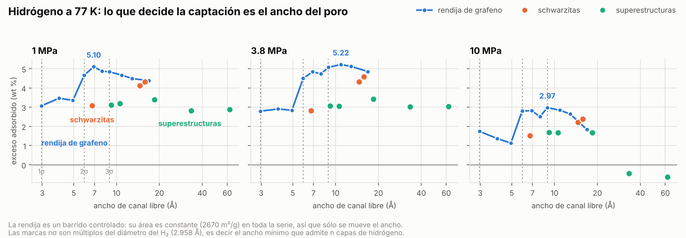

# La rendija de grafeno: el ancho de poro, con todo lo demás quieto

Diez rendijas de grafeno, de 6 a 20 Å entre paredes, a 77 K y 1, 3.8 y
10 MPa. Treinta puntos de Monte Carlo gran canónico.

**Esta serie existe por una razón metodológica, no por la rendija.** Las
seis estructuras medidas antes —tres schwarzitas en
`validacion_schwarzitas/` y tres superestructuras en
`validacion_superestructuras/`— varían el área, el ancho de poro y la
curvatura **a la vez**, así que ninguna diferencia entre ellas se podía
atribuir a ninguno de los tres. Una rendija de grafeno fija la química y
fija la curvatura en cero, y su área accesible resulta ser **constante en
toda la serie**. Queda una sola variable.



## El área constante es el control, y además calibra la medida

| H (centro a centro) | canal libre | área (m²/g) | vacío He |
|---|---|---|---|
| 6 Å | 2.97 Å | **1973** | 0.674 |
| 7 Å | 3.95 Å | 2670 | 0.809 |
| 8 Å | 4.93 Å | 2670 | 0.822 |
| 9 Å | 5.92 Å | 2670 | 0.834 |
| 10 Å | 6.91 Å | 2670 | 0.847 |
| 11 Å | 7.90 Å | 2670 | 0.860 |
| 12 Å | 8.89 Å | 2670 | 0.866 |
| 14 Å | 10.88 Å | 2670 | 0.885 |
| 16 Å | 12.88 Å | 2670 | 0.897 |
| 20 Å | 16.86 Å | 2670 | 0.919 |

De 7 Å en adelante el área no se mueve **ni un dígito**, que es lo que
tiene que pasar: el área de una lámina de grafeno con las dos caras
accesibles no depende de lo separadas que estén las láminas. A 6 Å cae a
1973 porque el canal (2.97 Å) deja de admitir la sonda con holgura y hay
superficie a la que no llega.

Y de paso es la **primera comprobación externa** que tiene esta rutina de
área: el valor teórico del grafeno con las dos caras es 2630 m²/g, y mide
2670 — un 1.5 % de diferencia. Hasta ahora sólo se había validado contra
sí misma (estable en el número de puntos, independiente de la semilla,
invariante al replicar la celda). Las tres pruebas siguen siendo
necesarias; ésta es la que dice que el número además es correcto.

El canal libre sale `H − 3.04 Å` en las diez, que es el diámetro de van
der Waals del carbono restado del centro a centro.

## Lo que mide: oscilaciones de capas, no una campana

Exceso adsorbido, en wt% de la masa total:

| H | canal | 1 MPa | 3.8 MPa | 10 MPa |
|---|---|---|---|---|
| 6 Å | 2.97 Å | 3.07 | 2.79 | 1.74 |
| 7 Å | 3.95 Å | 3.46 | 2.91 | 1.37 |
| 8 Å | 4.93 Å | 3.35 | 2.84 | 1.13 |
| **9 Å** | **5.92 Å** | 4.66 | 4.50 | 2.80 |
| 10 Å | 6.91 Å | **5.10** | 4.84 | 2.81 |
| 11 Å | 7.90 Å | 4.87 | 4.73 | 2.50 |
| **12 Å** | **8.89 Å** | 4.84 | 5.07 | **2.97** |
| 14 Å | 10.88 Å | 4.67 | **5.22** | 2.84 |
| 16 Å | 12.88 Å | 4.49 | 5.12 | 2.64 |
| 20 Å | 16.86 Å | 4.38 | 4.85 | 1.83 |

La curva no es una campana con un óptimo. **Los saltos caen en múltiplos
enteros del diámetro del hidrógeno**, σ = 2.958 Å:

- **1σ = 2.96 Å**, y el canal de H=6 mide **2.97**: una capa exacta.
- **2σ = 5.92 Å**, y el canal de H=9 mide **5.92**. Ahí está el salto
  grande, de 3.35 a 4.66 wt% a 1 MPa. El H=8, con 4.93 Å, se queda justo
  por debajo de poder meter la segunda capa: es el fondo del valle.
- **3σ = 8.87 Å**, y el canal de H=12 mide **8.89**. Ahí se recupera la
  curva tras el bache de H=11 (7.90 Å, justo por debajo), que sale
  **mínimo local en las tres presiones**: 4.87 / 4.73 / 2.50 contra sus
  dos vecinos a cada lado.

Es decir: cada vez que el canal cruza un múltiplo de σ entra una capa
nueva y la captación salta; justo antes de cruzarlo hay un hueco que no
da para la capa siguiente, y ese hueco es desperdicio. La rejilla
aterrizó en 1σ, 2σ y 3σ por casualidad — 6, 9 y 12 se eligieron para
acotar picos, no por esto — y es lo que hace la lectura inequívoca.

**El máximo se corre con la presión**, porque cada presión prefiere un
número de capas distinto: **H = 10 Å a 1 MPa**, **14 Å a 3.8 MPa**,
**12 Å a 10 MPa**. Comparar materiales a una sola presión, como se hizo
al principio de este estudio, puede invertir el orden.

**Y el valle se agrava con la presión.** H=8 pasa de 3.35 a 1.13 wt%
entre 1 y 10 MPa, mientras H=6 sólo baja de 3.07 a 1.74: cuanto más gas
hay disponible, más se nota el hueco que no se puede llenar.

## Lo que esto dice de las estructuras exóticas

A cada presión, el mejor de las diez rendijas contra el mejor de las seis
estructuras medidas antes:

| | mejor rendija | mejor estructura exótica |
|---|---|---|
| 1 MPa | **5.10** (H=10) | 4.32 (giroide) |
| 3.8 MPa | **5.22** (H=14) | 4.57 (giroide) |
| 10 MPa | **2.97** (H=12) | 2.38 (giroide) |

**A las tres presiones gana la rendija.** Ni los 48 heptágonos por celda
del giroide, ni los 360 pentágonos del superfulereno, ni la curvatura
negativa de una superficie mínima compran nada frente a dos láminas
planas a la distancia correcta. Y en la figura se ve lo mismo punto a
punto: a igualdad de ancho de canal, las estructuras exóticas caen **sobre
o por debajo** de la curva de la rendija.

Eso **no** dice que la topología no sirva para nada. Dice que, para
fisisorción de H₂ a 77 K con este modelo, la variable que manda es la
geometría del poro, y que una superestructura sólo puede ganar si llega a
anchos que una rendija no alcanza — o aportando algo que este modelo no
tiene: química distinta en la pared, que es exactamente el siguiente
paso (dopantes O, N, B, P, Se), y que necesita σ/ε por elemento.

## Se intentó llevar una superestructura a la banda buena, y no basta

La pregunta obvia tras lo anterior: si lo que importa es el ancho, ¿y si
se encoge una superestructura hasta ese ancho? Dos cosas lo impiden en
parte y una tercera lo impide del todo.

**La escala sola no es un parámetro libre.** A escalas 20, 24 y 28 con el
tubo de 5 Å de la súper-grafeno original, el constructor **rechaza** la
red: cada nodo se come unos `radio + blend` = 9 Å de *cada* extremo de un
strut, y por debajo de escala 38 no queda tubo entre nodos. El hueco y el
grosor de la pared están acoplados — `escala ≥ 2√3·(radio + blend)` — así
que estrechar la celda obliga a adelgazar el tubo a la vez. Eso sí
construye:

| | átomos | canal libre | área (m²/g) | vacío He | veredicto |
|---|---|---|---|---|---|
| escala 22, tubo 4, blend 2 | 2192 | **9.15 Å** | 1963 | 0.732 | TENSO |
| escala 26, tubo 5, blend 2 | 1588 | **10.57 Å** | 1995 | 0.744 | TENSO |
| escala 34, tubo 5, blend 4 | 2360 | 18.46 Å | 2250 | 0.808 | TENSO |

(La de escala 18 y tubo 3 también construye y sale ROTA: enlace de
1.585 Å. Las tres cumplen el presupuesto `sum(6-n) = −24` exacto y no
tienen un solo contacto por debajo de 2 Å.)

Los canales de 9.15 y 10.57 Å caen justo donde la rendija es mejor. Pero
**el área baja** — 2250 → 1995 → 1963 — que es el precio de estrechar una
red de tubos: más fracción de masa en la pared.

**La predicción se registró antes de correr**, para que pudiera fallar:
si el ancho es lo único que manda, la superestructura debería dar lo de
la rendija al mismo ancho multiplicado por el cociente de áreas. Falló.

| | canal | P (MPa) | wt% exc | rendija igual ancho | predicho × área | medido/predicho |
|---|---|---|---|---|---|---|
| escala 22 | 9.15 Å | 1.0 | 3.11 | 4.82 | 3.54 | **0.88** |
| | | 3.8 | 3.06 | 5.09 | 3.74 | **0.82** |
| | | 10.0 | 1.69 | 2.96 | 2.17 | **0.78** |
| escala 26 | 10.57 Å | 1.0 | 3.18 | 4.69 | 3.51 | **0.91** |
| | | 3.8 | 3.05 | 5.20 | 3.88 | **0.79** |
| | | 10.0 | 1.68 | 2.86 | 2.14 | **0.78** |

**Entre un 9 y un 22 % por debajo de lo que explica el área, y el déficit
crece con la presión.** Encoger ayuda algo —la eficiencia por área sube
de 0.75 en la escala 34 a 0.79 en la 22— pero no alcanza a la rendija.

### Y la explicación que se dio primero era falsa

Al medir esto se propuso que **igualar el diámetro de esfera libre fuese
una forma ingenua de igualar poros**: en una rendija de 9 Å todo punto
está a menos de 4.5 Å de una pared, mientras que un canal hexagonal con
la misma esfera inscrita tendría esquinas y un centro lejos de toda
pared, que se llenaría de gas casi libre. Encajaba con que el déficit
creciera con la presión.

**Se midió, y es falsa.** `analyse_porosity` reporta ahora
`mean_wall_distance`, la distancia media de un punto del volumen
accesible a la superficie del átomo más cercano. Para una rendija vale
`probe_radius/2 + canal/4` en forma cerrada, y las diez rendijas caen
sobre su valor analítico a ±0.04 Å o menos. Las superestructuras leen
**más bajo**, no más alto:

| | canal | pared media | rendija del mismo canal | exceso |
|---|---|---|---|---|
| súper-grafeno e22 | 9.15 Å | 2.77 Å | 3.01 Å | **−0.24** |
| súper-grafeno e26 | 10.57 Å | 2.87 Å | 3.37 Å | **−0.49** |

Su volumen accesible está **más cerca** de las paredes que el de una
rendija equivalente, no más lejos. La causa es que los tubos son huecos:
un tubo de radio 4 Å tiene un interior con radio libre de 2.4 Å, que el
H₂ alcanza, y ese volumen pegado a la pared arrastra la media.

Mirando la cola en vez de la media, que es lo que la bimodalidad pide,
la conclusión no cambia. Fracción del volumen accesible a más de una
distancia dada de la pared, contra la rendija del mismo canal:

| | > 2 Å | > 3 Å | > 4 Å | > 5 Å |
|---|---|---|---|---|
| súper-grafeno e22 | 0.711 | 0.336 | 0.146 | 0.044 |
| rendija igual | 0.823 | 0.503 | 0.184 | 0.000 |
| súper-grafeno e26 | 0.686 | 0.362 | 0.193 | 0.069 |
| rendija igual | 0.855 | 0.595 | 0.335 | 0.074 |

Hay algo de cola más allá de lo que una rendija puede tener —un 4.4 %
del volumen de la e22 está más lejos de una pared que **cualquier** punto
de su rendija equivalente, que es el centro de los hexágonos— pero un
4 % no explica un déficit del 9 al 22 %, y en todo lo demás la
superestructura tiene **menos** volumen lejos de la pared, no más.

Así que **la geometría del poro no explica el déficit**, y las dos
explicaciones que se propusieron están descartadas por medición. El
candidato que queda, y que aquí no se mide, es la **curvatura de la
pared**: la superficie de la superestructura es sobre todo exterior de
tubo, que es convexa, y una pared convexa tiene menos carbonos al
alcance de un punto dado que una lámina plana, así que su pozo de
potencial es menos profundo. Eso haría que cada m² valiese menos,
independientemente del ancho de poro — lo que encaja con que el déficit
aparezca en la eficiencia **por área**. Comprobarlo pide la distribución
de energía potencial del armazón, no de distancias.

## Límites

Los mismos que `validacion_superestructuras/`, y uno propio:

- Marco **rígido**, H₂ **esférico** (sin cuadrupolo ni rotaciones), **sin
  cargas**. Áreas geométricas, no BET.
- **Paredes de una sola capa**, elegido así a propósito: las paredes de
  las superestructuras son de una capa, así que ésta es su control y no
  otro material. Una pared de grafito de tres capas tiene un pozo de
  potencial algo más profundo y daría captaciones algo mayores.
- **Apilamiento AA.** A estas separaciones el registro entre capas es
  invisible para una molécula de H₂, y AA mantiene todos los huecos
  idénticos, que es el propósito de la serie.
- La rejilla no resuelve dónde está el máximo **dentro** de cada régimen
  de capas, sólo entre cuáles dos puntos cae.
- Las superestructuras encogidas se comparan con la rendija igualando la
  esfera libre mayor. Medida la distancia media a la pared (ver arriba),
  esa manera de igualar resultó **no** ser la causa del déficit, y la
  causa sigue sin establecerse.
- Tres puntos (H = 6, 9 y 16) traen el aviso de deriva del muestreo. Ese
  aviso está señalado como falso positivo en
  `validacion_superestructuras/README.md`: compara el primer bloque de
  producción con el último, que es la comparación más ruidosa posible con
  esos datos, y triplicar el equilibrado invirtió su signo sin mover la
  media.

## Reproducir

```bash
python construye.py <carpeta>              # las diez rendijas
python revisa.py   <carpeta>               # enlaces bajo PBC + porosidad
carbonforge adsorcion isoterma <carpeta>/rendija_10.extxyz <carpeta>/iso_10 \
    --temperatura 77 --presiones 1,3.8,10 \
    --equilibrado 1500000 --produccion 1500000 --instantaneas 1
python -m carbonforge.adsorption.run <carpeta>/iso_10
python informe.py <carpeta>                # la tabla, con las seis anteriores
python figura.py                           # ancho_vs_exceso.png
```
