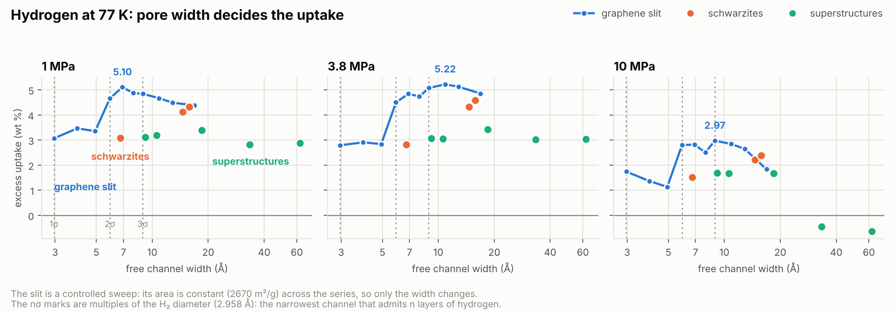

# La rendija de grafeno: el ancho de poro, con todo lo demás quieto

Diez rendijas de grafeno, de 6 a 20 Å entre paredes, a 77 K y 1, 3.8 y
10 MPa. Treinta puntos de Monte Carlo gran canónico.

**Esta serie existe por una razón metodológica, no por la rendija.** Las
seis estructuras medidas antes —tres schwarzitas en
`validacion_schwarzitas/` y tres superestructuras en
`validacion_superestructuras/`— varían el área, el ancho de poro y la
curvatura **a la vez**, así que ninguna diferencia entre ellas se podía
atribuir a ninguno de los tres. Una rendija de grafeno fija la química y
fija la curvatura en cero, y su área accesible resulta ser **constante en
toda la serie**. Queda una sola variable.



## El área constante es el control, y además calibra la medida

| H (centro a centro) | canal libre | área (m²/g) | vacío He |
|---|---|---|---|
| 6 Å | 2.97 Å | **1973** | 0.674 |
| 7 Å | 3.95 Å | 2670 | 0.809 |
| 8 Å | 4.93 Å | 2670 | 0.822 |
| 9 Å | 5.92 Å | 2670 | 0.834 |
| 10 Å | 6.91 Å | 2670 | 0.847 |
| 11 Å | 7.90 Å | 2670 | 0.860 |
| 12 Å | 8.89 Å | 2670 | 0.866 |
| 14 Å | 10.88 Å | 2670 | 0.885 |
| 16 Å | 12.88 Å | 2670 | 0.897 |
| 20 Å | 16.86 Å | 2670 | 0.919 |

De 7 Å en adelante el área no se mueve **ni un dígito**, que es lo que
tiene que pasar: el área de una lámina de grafeno con las dos caras
accesibles no depende de lo separadas que estén las láminas. A 6 Å cae a
1973 porque el canal (2.97 Å) deja de admitir la sonda con holgura y hay
superficie a la que no llega.

Y de paso es la **primera comprobación externa** que tiene esta rutina de
área: el valor teórico del grafeno con las dos caras es 2630 m²/g, y mide
2670 — un 1.5 % de diferencia. Hasta ahora sólo se había validado contra
sí misma (estable en el número de puntos, independiente de la semilla,
invariante al replicar la celda). Las tres pruebas siguen siendo
necesarias; ésta es la que dice que el número además es correcto.

El canal libre sale `H − 3.04 Å` en las diez, que es el diámetro de van
der Waals del carbono restado del centro a centro.

## Lo que mide: oscilaciones de capas, no una campana

Exceso adsorbido, en wt% de la masa total:

| H | canal | 1 MPa | 3.8 MPa | 10 MPa |
|---|---|---|---|---|
| 6 Å | 2.97 Å | 3.07 | 2.79 | 1.74 |
| 7 Å | 3.95 Å | 3.46 | 2.91 | 1.37 |
| 8 Å | 4.93 Å | 3.35 | 2.84 | 1.13 |
| **9 Å** | **5.92 Å** | 4.66 | 4.50 | 2.80 |
| 10 Å | 6.91 Å | **5.10** | 4.84 | 2.81 |
| 11 Å | 7.90 Å | 4.87 | 4.73 | 2.50 |
| **12 Å** | **8.89 Å** | 4.84 | 5.07 | **2.97** |
| 14 Å | 10.88 Å | 4.67 | **5.22** | 2.84 |
| 16 Å | 12.88 Å | 4.49 | 5.12 | 2.64 |
| 20 Å | 16.86 Å | 4.38 | 4.85 | 1.83 |

La curva no es una campana con un óptimo. **Los saltos caen en múltiplos
enteros del diámetro del hidrógeno**, σ = 2.958 Å:

- **1σ = 2.96 Å**, y el canal de H=6 mide **2.97**: una capa exacta.
- **2σ = 5.92 Å**, y el canal de H=9 mide **5.92**. Ahí está el salto
  grande, de 3.35 a 4.66 wt% a 1 MPa. El H=8, con 4.93 Å, se queda justo
  por debajo de poder meter la segunda capa: es el fondo del valle.
- **3σ = 8.87 Å**, y el canal de H=12 mide **8.89**. Ahí se recupera la
  curva tras el bache de H=11 (7.90 Å, justo por debajo), que sale
  **mínimo local en las tres presiones**: 4.87 / 4.73 / 2.50 contra sus
  dos vecinos a cada lado.

Es decir: cada vez que el canal cruza un múltiplo de σ entra una capa
nueva y la captación salta; justo antes de cruzarlo hay un hueco que no
da para la capa siguiente, y ese hueco es desperdicio. La rejilla
aterrizó en 1σ, 2σ y 3σ por casualidad — 6, 9 y 12 se eligieron para
acotar picos, no por esto — y es lo que hace la lectura inequívoca.

**El máximo se corre con la presión**, porque cada presión prefiere un
número de capas distinto: **H = 10 Å a 1 MPa**, **14 Å a 3.8 MPa**,
**12 Å a 10 MPa**. Comparar materiales a una sola presión, como se hizo
al principio de este estudio, puede invertir el orden.

**Y el valle se agrava con la presión.** H=8 pasa de 3.35 a 1.13 wt%
entre 1 y 10 MPa, mientras H=6 sólo baja de 3.07 a 1.74: cuanto más gas
hay disponible, más se nota el hueco que no se puede llenar.

## Lo que esto dice de las estructuras exóticas

A cada presión, el mejor de las diez rendijas contra el mejor de las seis
estructuras medidas antes:

| | mejor rendija | mejor estructura exótica |
|---|---|---|
| 1 MPa | **5.10** (H=10) | 4.32 (giroide) |
| 3.8 MPa | **5.22** (H=14) | 4.57 (giroide) |
| 10 MPa | **2.97** (H=12) | 2.38 (giroide) |

**A las tres presiones gana la rendija.** Ni los 48 heptágonos por celda
del giroide, ni los 360 pentágonos del superfulereno, ni la curvatura
negativa de una superficie mínima compran nada frente a dos láminas
planas a la distancia correcta. Y en la figura se ve lo mismo punto a
punto: a igualdad de ancho de canal, las estructuras exóticas caen **sobre
o por debajo** de la curva de la rendija.

Eso **no** dice que la topología no sirva para nada. Dice que, para
fisisorción de H₂ a 77 K con este modelo, la variable que manda es la
geometría del poro, y que una superestructura sólo puede ganar si llega a
anchos que una rendija no alcanza — o aportando algo que este modelo no
tiene: química distinta en la pared, que es exactamente el siguiente
paso (dopantes O, N, B, P, Se), y que necesita σ/ε por elemento.

## Se intentó llevar una superestructura a la banda buena, y no basta

La pregunta obvia tras lo anterior: si lo que importa es el ancho, ¿y si
se encoge una superestructura hasta ese ancho? Dos cosas lo impiden en
parte y una tercera lo impide del todo.

**La escala sola no es un parámetro libre.** A escalas 20, 24 y 28 con el
tubo de 5 Å de la súper-grafeno original, el constructor **rechaza** la
red: cada nodo se come unos `radio + blend` = 9 Å de *cada* extremo de un
strut, y por debajo de escala 38 no queda tubo entre nodos. El hueco y el
grosor de la pared están acoplados — `escala ≥ 2√3·(radio + blend)` — así
que estrechar la celda obliga a adelgazar el tubo a la vez. Eso sí
construye:

| | átomos | canal libre | área (m²/g) | vacío He | veredicto |
|---|---|---|---|---|---|
| escala 22, tubo 4, blend 2 | 2192 | **9.15 Å** | 1963 | 0.732 | TENSO |
| escala 26, tubo 5, blend 2 | 1588 | **10.57 Å** | 1995 | 0.744 | TENSO |
| escala 34, tubo 5, blend 4 | 2360 | 18.46 Å | 2250 | 0.808 | TENSO |

(La de escala 18 y tubo 3 también construye y sale ROTA: enlace de
1.585 Å. Las tres cumplen el presupuesto `sum(6-n) = −24` exacto y no
tienen un solo contacto por debajo de 2 Å.)

Los canales de 9.15 y 10.57 Å caen justo donde la rendija es mejor. Pero
**el área baja** — 2250 → 1995 → 1963 — que es el precio de estrechar una
red de tubos: más fracción de masa en la pared.

**La predicción se registró antes de correr**, para que pudiera fallar:
si el ancho es lo único que manda, la superestructura debería dar lo de
la rendija al mismo ancho multiplicado por el cociente de áreas. Falló.

| | canal | P (MPa) | wt% exc | rendija igual ancho | predicho × área | medido/predicho |
|---|---|---|---|---|---|---|
| escala 22 | 9.15 Å | 1.0 | 3.11 | 4.82 | 3.54 | **0.88** |
| | | 3.8 | 3.06 | 5.09 | 3.74 | **0.82** |
| | | 10.0 | 1.69 | 2.96 | 2.17 | **0.78** |
| escala 26 | 10.57 Å | 1.0 | 3.18 | 4.69 | 3.51 | **0.91** |
| | | 3.8 | 3.05 | 5.20 | 3.88 | **0.79** |
| | | 10.0 | 1.68 | 2.86 | 2.14 | **0.78** |

**Entre un 9 y un 22 % por debajo de lo que explica el área, y el déficit
crece con la presión.** Encoger ayuda algo —la eficiencia por área sube
de 0.75 en la escala 34 a 0.79 en la 22— pero no alcanza a la rendija.

### Y la explicación que se dio primero era falsa

Al medir esto se propuso que **igualar el diámetro de esfera libre fuese
una forma ingenua de igualar poros**: en una rendija de 9 Å todo punto
está a menos de 4.5 Å de una pared, mientras que un canal hexagonal con
la misma esfera inscrita tendría esquinas y un centro lejos de toda
pared, que se llenaría de gas casi libre. Encajaba con que el déficit
creciera con la presión.

**Se midió, y es falsa.** `analyse_porosity` reporta ahora
`mean_wall_distance`, la distancia media de un punto del volumen
accesible a la superficie del átomo más cercano. Para una rendija vale
`probe_radius/2 + canal/4` en forma cerrada, y las diez rendijas caen
sobre su valor analítico a ±0.04 Å o menos. Las superestructuras leen
**más bajo**, no más alto:

| | canal | pared media | rendija del mismo canal | exceso |
|---|---|---|---|---|
| súper-grafeno e22 | 9.15 Å | 2.77 Å | 3.01 Å | **−0.24** |
| súper-grafeno e26 | 10.57 Å | 2.87 Å | 3.37 Å | **−0.49** |

Su volumen accesible está **más cerca** de las paredes que el de una
rendija equivalente, no más lejos. La causa es que los tubos son huecos:
un tubo de radio 4 Å tiene un interior con radio libre de 2.4 Å, que el
H₂ alcanza, y ese volumen pegado a la pared arrastra la media.

Mirando la cola en vez de la media, que es lo que la bimodalidad pide,
la conclusión no cambia. Fracción del volumen accesible a más de una
distancia dada de la pared, contra la rendija del mismo canal:

| | > 2 Å | > 3 Å | > 4 Å | > 5 Å |
|---|---|---|---|---|
| súper-grafeno e22 | 0.711 | 0.336 | 0.146 | 0.044 |
| rendija igual | 0.823 | 0.503 | 0.184 | 0.000 |
| súper-grafeno e26 | 0.686 | 0.362 | 0.193 | 0.069 |
| rendija igual | 0.855 | 0.595 | 0.335 | 0.074 |

Hay algo de cola más allá de lo que una rendija puede tener —un 4.4 %
del volumen de la e22 está más lejos de una pared que **cualquier** punto
de su rendija equivalente, que es el centro de los hexágonos— pero un
4 % no explica un déficit del 9 al 22 %, y en todo lo demás la
superestructura tiene **menos** volumen lejos de la pared, no más.

Así que **la geometría del poro no explica el déficit**, y las dos
explicaciones que se propusieron están descartadas por medición. El
candidato que quedaba era la **curvatura de la pared**: la superficie
de la superestructura es sobre todo exterior de tubo, que es convexa, y
una pared convexa tiene menos carbonos al alcance de un punto dado que
una lámina plana, así que su pozo de potencial es menos profundo. Eso
haría que cada m² valiese menos, independientemente del ancho de poro —
lo que encaja con que el déficit aparezca en la eficiencia **por área**.

## Y la curvatura sí lo explica: 24 % del pozo

Ya se puede medir: `analyse_porosity` informa ahora la distribución de
energía potencial del armazón sobre el volumen accesible, y
`curvatura.py` aísla la variable. Una pared cada vez, misma densidad de
carbono, misma sonda, misma temperatura, y la sonda **se barre** hacia
afuera para leer cada pared en SU propio mínimo y no en el del plano:

| (n,n) | R (Å) | pozo (K) | distancia (Å) | % del plano |
|---|---|---|---|---|
| (5,5) | 3.39 | −333.5 | 3.22 | 73.9 % |
| (6,6) | 4.07 | −344.5 | 3.22 | **76.4 %** |
| (8,8) | 5.42 | −361.2 | 3.22 | 80.1 % |
| (10,10) | 6.78 | −373.2 | 3.22 | 82.7 % |
| (15,15) | 10.17 | −392.2 | 3.22 | 87.0 % |
| (20,20) | 13.56 | −403.7 | 3.22 | 89.5 % |
| (30,30) | 20.34 | −416.7 | 3.22 | 92.4 % |
| plana | ∞ | −451.0 | 3.22 | 100.0 % |

El exterior de un (6,6) —que es el puntal de estas superestructuras—
vale **el 76 % del pozo de una lámina plana**. El déficit crece al
cerrarse el radio y **se va a cero cuando el radio crece**, que es el
límite que convierte esto en una medida y no en un relato: una pared de
radio 20 Å ya está al 92 % del plano.

Y la distancia del mínimo **no se mueve**: 3.22 Å en las ocho filas. O
sea que no es que la molécula se siente en otro sitio, es que desde el
mismo sitio ve menos carbono. Que es exactamente el mecanismo
propuesto, y no otro compatible con el mismo número.

### Lo que NO dice

Un haz de tubos medido entero sale **más** hondo que una rendija
(−493 K de media contra −347 K sobre el volumen accesible, a 77 K), y
eso no contradice lo anterior: en un haz, un sitio del surco ve
carbono de **tres** tubos a la vez, y la superposición recupera con
creces lo que la convexidad cuesta por pared. El déficit de las
superestructuras es que tienen superficie convexa **abierta** —poros
grandes, sin surcos— así que pagan el 24 % sin cobrar la superposición.
Esa es la consecuencia de diseño: lo que hay que buscar no es más área,
son surcos.

## Límites

Los mismos que `validacion_superestructuras/`, y uno propio:

- Marco **rígido**, H₂ **esférico** (sin cuadrupolo ni rotaciones), **sin
  cargas**. Áreas geométricas, no BET.
- **Paredes de una sola capa**, elegido así a propósito: las paredes de
  las superestructuras son de una capa, así que ésta es su control y no
  otro material. Una pared de grafito de tres capas tiene un pozo de
  potencial algo más profundo y daría captaciones algo mayores.
- **Apilamiento AA.** A estas separaciones el registro entre capas es
  invisible para una molécula de H₂, y AA mantiene todos los huecos
  idénticos, que es el propósito de la serie.
- La rejilla no resuelve dónde está el máximo **dentro** de cada régimen
  de capas, sólo entre cuáles dos puntos cae.
- Las superestructuras encogidas se comparan con la rendija igualando la
  esfera libre mayor. Medida la distancia media a la pared (ver arriba),
  esa manera de igualar resultó **no** ser la causa del déficit, y la
  causa sigue sin establecerse.
- Tres puntos (H = 6, 9 y 16) traen el aviso de deriva del muestreo. Ese
  aviso está señalado como falso positivo en
  `validacion_superestructuras/README.md`: compara el primer bloque de
  producción con el último, que es la comparación más ruidosa posible con
  esos datos, y triplicar el equilibrado invirtió su signo sin mover la
  media.

## Reproducir

```bash
python construye.py <carpeta>              # las diez rendijas
python revisa.py   <carpeta>               # enlaces bajo PBC + porosidad
carbonforge adsorcion isoterma <carpeta>/rendija_10.extxyz <carpeta>/iso_10 \
    --temperatura 77 --presiones 1,3.8,10 \
    --equilibrado 1500000 --produccion 1500000 --instantaneas 1
python -m carbonforge.adsorption.run <carpeta>/iso_10
python informe.py <carpeta>                # la tabla, con las seis anteriores
python figura.py                           # ancho_vs_exceso.png
```

## El pozo de un surco: `surco.py`

`curvatura.py` cerró el *por qué* del déficit por m² de las
superestructuras — su superficie es sobre todo el EXTERIOR de un tubo, y
una pared convexa tiene menos carbonos al alcance de un punto que una
lámina plana de la misma densidad: **76.4 %** del pozo plano para un
(6,6). Eso deja abierta la pregunta de diseño, porque el adsorbente de
una superestructura no es una pared: donde dos tubos corren paralelos
dejan un **surco**, y un punto en la hendidura ve dos paredes convexas a
la vez. `surco.py` mide las tres geometrías con lo único distinto siendo
la forma (mismo carbono, misma sonda, 77 K, mismo barrido).

| hueco (Å) | rendija (K) | surco (K) | surco / rendija | surco / pared plana |
|---|---|---|---|---|
| 3.0 | vacía | -700.9 | -- | 155.4 % |
| 3.4 | vacía | -696.6 | -- | 154.5 % |
| 4.0 | vacía | -691.0 | -- | 153.2 % |
| 5.0 | vacía | -691.9 | -- | 153.4 % |
| 6.0 | -766.1 | -703.9 | 91.9 % | 156.1 % |
| **7.0** | **-817.4** | -611.6 | 74.8 % | 135.6 % |
| 8.0 | -604.5 | -413.6 | 68.4 % | 91.7 % |
| 10.0 | -488.5 | -174.8 | 35.8 % | 38.8 % |
| 12.0 | -463.9 | -81.9 | 17.7 % | 18.2 % |

Pared plana suelta: **-451.0 K**. Pared convexa (6,6) suelta: -344.5 K.

Dos conclusiones, y van en direcciones opuestas:

* **El surco paga la convexidad con creces.** -700.9 K contra los
  -344.5 de la pared desnuda: **2.03 veces**, y **155 %** de una lámina
  plana. El déficit del 24 % que `curvatura.py` midió no es el final de
  la cuenta; dos paredes convejas enfrentadas superan a una plana.
* **Y sigue sin ganarle a una rendija bien elegida.** El mejor surco
  (-703.9 K a 6 Å) es el **86 %** del mejor pozo de rendija (-817.4 K a
  7 Å). La superestructura no es un adsorbente mejor que el carbón de
  rendijas; es uno comparable con una red abierta, que es otro
  argumento.

**Dos cotas de barrido eran el resultado antes de arreglarlas**, y las
dos daban números de la superficie equivocada:

* El barrido de la rendija salía por la pared opuesta y encontraba su
  mínimo en el **exterior de una bicapa**. Así una rendija de 3.0 Å
  —que no admite nada— se informaba a -503.7 K. Acotado al interior,
  sale `vacía`, que es la respuesta.
* El del surco empezaba a 0.5 Å del eje de simetría, y con hueco ancho
  el sitio más profundo **es el eje**: todos los huecos de 7 Å en
  adelante informaban su mínimo exactamente en el suelo del barrido. El
  surco se barre desde 0.

```bash
uv run python validacion_rendijas/surco.py
```

## ¿A qué presión llena cada geometría? `llenado.py`

`curvatura.py` y `surco.py` miden la **profundidad** de un pozo. Eso no
es la respuesta de diseño: lo que se elige es cuánto se adsorbe a la
presión disponible, y a baja presión eso es la **pendiente inicial** de
la isoterma — el coeficiente de Henry, que es una media de Widom sobre
la celda vacía y cuesta segundos donde una isoterma cuesta días
(`adsorption/henry.py`).

Es el límite del **mismo** GCMC, no un segundo modelo: el mismo
reservorio (`VirialGas.activity`) y el mismo par H₂-C con corrección de
Feynman-Hibbs. `tests/test_adsorption_henry.py` fija las dos mitades de
esa afirmación: a 1 kPa el GCMC cae sobre la tangente (6.03 moléculas
frente a 6.19, un 2.5 %) y a 10 kPa ya se ha separado un 25 %, que es
donde acaba el régimen lineal.

Dos geometrías, un mando cada una, misma química:

| | mejor pendiente | K_H (mol/kg/MPa) | pozo más profundo | q_st (kJ/mol) |
|---|---|---|---|---|
| rendija | H = 6.6 Å (canal 3.5 Å) | **8660 ± 50** | H = 6.4 Å | 7.81 |
| haz de tubos (surcos) | hueco = 4.0 Å | 4252 ± 107 | hueco = 3.8 Å | **8.96** |

**Las dos columnas no premian a la misma geometría, y eso es el
resultado.**

* **El surco gana en profundidad de pozo**, 8.96 contra 7.81 kJ/mol — y
  gana por más de lo que `surco.py` sugería. La razón es geométrica y
  corrige el encuadre de esa sección: el surco de un haz triangular es
  una cuña de **tres** tubos, no de dos, y el punto en ella ve tres
  paredes convexas. La hipótesis del surco queda confirmada en su mejor
  versión.
* **La rendija gana en pendiente por gramo**, 8660 contra 4252: un
  factor **2.04**. Y el
  motivo no es el pozo: `K_H` es **por kilogramo de armazón**, y un haz
  gasta la mayor parte de su carbono en paredes de tubo que miran a un
  interior vacío, mientras que en una rendija cada carbono da a un poro
  que trabaja. **Sitios mejores, y menos de ellos por gramo.**

Así que la respuesta a "¿llena antes una red abierta?" es **no** — pero
por un factor 2, no por el 86 % que sugería comparar pozos de dos tubos,
y el límite real no es la convexidad sino la **densidad de sitios por
gramo**. Que es un problema distinto y con otra cura: no ensanchar el
poro, sino adelgazar el armazón.

Tres cosas que el barrido enseñó y que un barrido grueso habría
escondido:

* **`K_H` va como `exp(q_st/RT)` y `RT` es 0.64 kJ/mol a 77 K**, así que
  un pozo 1.8 kJ/mol más profundo es un factor 16. La serie gruesa de
  `construye.py` (6, 7, 8, 10, 14, 20 Å) **se salta el óptimo de la
  rendija**: da 760 a 6.0 y 717 a 8.0 con 8660 en medio. Un barrido
  demasiado grueso no desenfoca el óptimo, informa de otro adsorbente.
* **El 6.0 Å del haz que usa la referencia no es su óptimo.** Levesque
  probó 3.4 y 6.0 y encontró 6.0 mejor de los dos, lo cual es cierto;
  el máximo está en 4.0 Å, con `K_H` 5.5 veces el de 6.0 (4252 contra 775). Las
  isotermas ya corridas en este repositorio están todas en 6.0.
* **El error propio de la media de Widom subestima el del haz.** Las
  semillas coinciden al 1 % en una rendija y al 6 % en un haz cerca de
  su pico, porque allí los sitios profundos son una fracción pequeña de
  una celda grande. `llenado.py` corre dos semillas y publica la
  separación entre ellas, no el error interno.

Lo que esto **no** mide: super-grafeno ni supertubo. Esos llevan nodos,
y un nodo no es ni surco ni rendija. El haz es el adsorbente de surcos
en su forma idealizada —todo surco, ningún nodo— y, a diferencia de
cualquier superestructura de este repositorio, tiene una isoterma
publicada detrás (`validacion_GCMC/`).

Tampoco mide una presión de media carga: eso necesita una carga de
saturación, que sale de una isoterma y no del límite de cobertura cero.
`HenryReport.half_filling_pressure` la calcula si se le da una, y dice
que el supuesto de Langmuir es un supuesto.

```bash
uv run python validacion_rendijas/llenado.py
```

## Y las superredes de verdad: `llenado_super.py`

`llenado.py` compara una pared plana con un surco **idealizado** —todo
surco, ningún nodo— porque una superred lleva nodos y un nodo no es ni
surco ni rendija. Esta es la cosa real: súper-cuadrado, súper-grafeno,
súper-cúbico y súper-fcc, construidas con `nanocarbon_lab` en sus
presets de catálogo y entregadas por fichero (ningún paquete importa al
otro), empotradas en celda legal aquí.

A 77 K, un millón de inserciones por dos semillas:

| estructura | átomos | canal (Å) | área (m²/g) | K_H (mol/kg/MPa) | q_st (kJ/mol) |
|---|---|---|---|---|---|
| **rendija, H = 6.6 Å** | 960 | 3.55 | — | **8660 ± 50** | 7.81 |
| súper-cúbico | 836 | 20.00 | 2314 | 4956 ± 101 | **8.90** |
| haz de tubos, hueco 4.0 Å | 8704 | 10.21 | — | 4252 ± 107 | **8.96** |
| súper-cuadrado | 1328 | 20.22 | 2351 | 4225 ± 5 | 8.47 |
| súper-grafeno | 2360 | 18.46 | 2249 | 4057 ± 35 | 8.56 |
| súper-fcc | 2982 | 7.33 | 1760 | **633 ± 6** | 7.30 |

Cuatro cosas, y ninguna era la esperada:

* **El nodo no estropea nada.** Tres de las cuatro caen exactamente
  donde cae el haz idealizado (4000–5000), y el súper-cúbico queda por
  encima de él. Los nodos eran la razón para no extrapolar del haz a la
  superred; medido, la extrapolación valía. El nodo es una minoría de
  la pared y no estrangula el canal.
* **El súper-fcc es la excepción, y pierde por un factor 7.** Su canal
  es de 7.33 Å contra 18–20 Å de las otras y su área 1760 contra
  2250–2350: doce tubos en un nodo no dejan sitio para una pared entre
  ellos, que es lo que el catálogo de `nanocarbon_lab` ya dice de él
  («se informa, no se recomienda»). Aquella advertencia era sobre la
  geometría de la pared; **esto es la misma conclusión llegando desde
  la adsorción, que es una comprobación independiente.**
* **La rendija óptima sigue ganando la pendiente por gramo, 1.75×, con
  el pozo MÁS SOMERO de la tabla salvo el fcc.** Esa es la frase que
  resume todo el estudio: `K_H` ≈ densidad de sitios × `exp(q/RT)`, y
  la rendija tiene sitios mediocres **en todas partes** mientras las
  superredes tienen sitios excelentes en unos pocos. Gana el que tiene
  más sitios por gramo, no el que tiene los mejores.
* **El orden no sigue ni al área ni al canal.** El súper-cuadrado tiene
  el área mayor (2351 m²/g) y el canal más ancho (20.22 Å) y no es el
  mejor; el súper-cúbico, con menos área y canal más estrecho, lo
  supera. `K_H` sigue a `q_st`, no al área — que es por qué el área
  geométrica no es la cifra de mérito a baja presión y por qué
  `curvatura.py` buscaba en el sitio correcto al mirar pozos.

Dos notas de método que costaron una medida cada una:

* **Estas celdas son casi todas vacío, así que su media de Widom
  converge más despacio que la de una rendija** y a 200 000
  inserciones el propio informe avisaba (5–7 % de error en el
  súper-cúbico y el fcc). A 10⁶ el aviso desaparece y los valores
  apenas se mueven (4862 → 4956, 640 → 633), o sea que el aviso era
  conservador y aun así había que atenderlo. El número de muestras es
  un argumento del script precisamente porque la respuesta al aviso es
  subirlo.
* **A 10⁶ puntos el proceso moría sin traza**, porque `query_ball_point`
  sobre todos los puntos a la vez guarda un millón de listas de
  vecinos. Es la misma clase de fallo que el campo de red sin trocear
  de `implicit.py` y la misma cura: la evaluación va en bloques
  (`henry.CHUNK`). Los puntos se sortean de una vez, así que el tamaño
  de bloque no puede cambiar la respuesta, y un test lo fija a 1e-12.

El súper-cúbico se construye con el rescate de pared colapsada activo
(`nanocarbon_lab` avisa y lo reconstruye con la pared sujeta a su
superficie); lo que se mide aquí es la estructura rescatada, no la
colapsada.

```bash
# en nanocarbon_lab, que escribe los extxyz:
#   python construye_super.py <carpeta>
uv run python validacion_rendijas/llenado_super.py <carpeta> 1000000
```

## Otros adsorbatos: `adsorbatos.py`

La rendija que gana a 6.6 Å gana **porque es estrecha**: un canal de
3.55 Å, apenas más que el diámetro del propio H₂, con las dos paredes
al alcance a la vez. Un adsorbato más grande no cabe ahí, la rendija
tiene que abrirse para alojarlo y al abrirse sus dos paredes dejan de
actuar juntas. Los canales de las superredes son de 18–20 Å y no se
enteran. **Así que una molécula mayor debería cerrar la brecha**, y la
pregunta es si la cierra lo suficiente.

### Hay que comparar a temperatura REDUCIDA igualada, no a la misma temperatura

Esto es la mitad del trabajo y es donde estaba la trampa. 77 K le va al
hidrógeno porque su temperatura crítica son 33 K: es gas por un factor
2.33. **El Ar, el N₂ y el CH₄ a 77 K están todos por debajo de su
crítica** (151, 126 y 191 K), así que ahí el poro no adsorbe, se llena
por condensación capilar, y una pendiente de cobertura cero es la
tangente a una isoterma cuyo tramo lineal acaba en la presión de
saturación — del orden de 10⁻⁵ Pa para el metano. Medido a 77 K de
todos modos, el CH₄ da **1.6×10¹⁰ mol/kg/MPa** contra los 714 del H₂:
un número sobre el estado, no sobre la molécula.

`potentials.matched_temperature` pone cada uno donde está el H₂ a 77 K
(Ne 104 K, N₂ 295 K, Ar 352 K, CH₄ 445 K), y `henry_constant` **avisa**
cuando se le pide una temperatura por debajo de la crítica del
adsorbato. Eso no es una temperatura de aplicación —nadie almacena
metano a 445 K— es la comparación que aísla la **geometría**, que es la
pregunta de diseño. La respuesta de ingeniería necesita cada adsorbato
a su temperatura de trabajo, y es otra tabla.

### El carbono sale de lo que ya había, y una trampa de masa

Lorentz-Berthelot invertido sobre `H2_C` y `H2_H2` fija el carbono:
ε = 27.99 K, σ = 3.402 Å, que es el juego de parámetros de grafito de
toda la literatura. Derivarlo así en vez de copiarlo significa que no
puede desviarse de los dos pares con los que se calculó la isoterma
validada, y `with_carbon(H2_SELF)` reproduce `H2_C` exacto.

**`H2_H2` lleva la masa reducida de un par de moléculas (la mitad),
porque describe dos moléculas chocando.** Contra una pared rígida la
masa es la de la molécula: la pared no retrocede. El término de
Feynman-Hibbs va como `1/μ`, así que pasar `H2_H2` donde va `H2_SELF`
duplica la corrección cuántica — invisible en la forma de todo lo que
toca, igual que la constante `ħ²/k_B` que una vez estuvo mal por tres.
`H2_SELF` existe para eso y un test fija la diferencia.

### Y el fallo que esto destapó: el recorte tiene que llegar a las dos sumas

Una inserción solapada tiene energía finita pero astronómica (10²⁰ K y
más, del término r⁻¹²). El peso de Boltzmann se calcula con la energía
**recortada**, y la media ponderada usaba la energía **sin recortar**:
un número que se desvanece multiplicado por uno enorme. A 77 K el
factor es `exp(-130)` y el producto desaparece; a 352 K es `exp(-28)` y
no, y el pozo medio salió **-4.6×10⁹ kJ/mol**. O sea que el fallo era
invisible a la única temperatura a la que se había medido nada en este
repositorio, y apareció en el primer adsorbato que exigió otra.

Tres cosas se arreglaron a la vez, y las tres eran la misma
negligencia:

* el recorte (`henry.ENERGY_CAP`) se aplica una vez y alimenta las dos
  sumas;
* el guardia de calor implausible leía `heat > limite` y el fallo
  producía **-4.6e9**, así que no lo veía: un guardia de cordura que
  sólo mira hacia un lado no es un guardia;
* `adsorbatos.py` descartaba todos los avisos del informe salvo el de
  la crítica — y el aviso que sí saltó («no liga nada») era
  exactamente éste. Los avisos de un informe son parte de su
  resultado, y ahora se imprimen.

Un test mide ahora `q_st` para los cinco adsorbatos a su temperatura
igualada y exige que caiga en un rango físico, que es la prueba que
faltaba: todo estaba medido a una sola temperatura.

**Y un test estaba verde por culpa del fallo.** `test_the_temperature_
enters_twice` afirmaba que `q_st` baja al subir la temperatura; es
falso, porque `q_st = -<U> + RT` y `RT` pasa de 0.64 kJ/mol a 77 K a
2.44 a 293, así que el calor **sube** mientras el pozo ponderado se
hace más profundo al enfriar (-573 K contra -550 K). Pasaba porque el
desbordamiento sin recortar envenenaba el caso caliente — verde por la
razón que el test existía para cazar.

```bash
uv run python validacion_rendijas/adsorbatos.py <carpeta>
```

### El resultado: ningún adsorbato rescata a las superredes

| adsorbato | T (K) | σ con C (Å) | H óptimo (Å) | K_H rendija | mejor superred | razón |
|---|---|---|---|---|---|---|
| Ne | 104 | 3.096 | 6.4 | 333 | súper-cúbico 107 | **0.32×** |
| H₂ | 77 | 3.180 | 6.6 | 8660 | súper-cúbico 4862 | **0.56×** |
| Ar | 352 | 3.404 | 7.0 | 6.32 | súper-cuadrado 3.45 | **0.55×** |
| N₂ | 295 | 3.550 | 7.4 | 16.9 | súper-cuadrado 9.77 | **0.58×** |
| CH₄ | 445 | 3.566 | 7.4 | 4.33 | súper-cúbico 2.56 | **0.59×** |

(Las `K_H` **no son comparables entre filas**: cada una está a su
propia temperatura, y `K_H` depende exponencialmente de ella. Lo
comparable es la razón dentro de cada fila.)

**La hipótesis era que una molécula mayor cerraría la brecha. No la
cierra.** La razón se queda entre 0.3 y 0.6 a lo largo de un rango de
σ de 3.10 a 3.57 Å — sube de 0.56 a 0.59 del H₂ al CH₄, que es ruido
al lado del factor 2 que haría falta.

Y el barrido dice por qué, con una regularidad que no esperaba:

```
H_óptimo = 2.13 σ − 0.19      (r = 0.997 sobre los cinco)
```

**El óptimo de la rendija es el que aloja exactamente una capa
molecular, y ese ancho existe para cualquier molécula.** La rendija
tiene un parámetro libre y se reajusta a lo que se le dé; el canal de
una superred está fijado por la geometría de su nodo en 18–20 Å —cinco
capas moleculares— y no se reajusta a nada. La comparación nunca fue
«superred contra rendija», fue «superred contra la mejor rendija *para
esta molécula*», y la rendija siempre tiene una.

El Ne es el caso que lo confirma por el otro lado: es **más pequeño**
que el H₂, estrecha el óptimo a 6.4 Å y hunde la razón a 0.32. Si el
tamaño manda, tiene que empeorar al encoger, y empeora.

**Así que la pregunta estaba mal dirigida, y la propia respuesta dice
hacia dónde.** Lo que le falta a la superred no es un adsorbato
distinto: es su propio parámetro libre. `scale` y `tube_radius` son
argumentos de `build_supernetwork`, y el canal de 20 Å del
súper-cúbico sale de `scale=34, tube_radius=5`, que es un preset, no
un óptimo. Estrechar la celda hacia su mínimo construible es
exactamente el ajuste que la rendija ya disfruta, y es lo único
medido aquí que podría cambiar la tabla. Eso sí hay que probarlo
—cada celda es una construcción de minutos— pero es una búsqueda en un
parámetro, no en el catálogo.

Sobre la elección de adsorbatos: el **Ar** es el único donde un solo
centro Lennard-Jones no es aproximación ninguna; el **CH₄** es el
átomo unido estándar y es buen modelo; el **N₂** de un solo centro
pierde su elongación y su cuadrupolo, así que vale para la tendencia y
no para citar un número suyo. El **CO₂** no está, y no por descuido.

El súper-fcc se dejó fuera a propósito: con H₂ ya pierde un factor 7
por su canal de 7.3 Å, y una molécula mayor sólo puede empeorarlo.

## Afinar la celda, y la ruta que lo hace innecesario

La tabla de adsorbatos acabó en que el canal de 20 Å del súper-cúbico
sale del preset `34/5/4` y no de ningún óptimo, mientras la rendija que
le gana vence por alojar exactamente una capa molecular. `scale` y
`tube_radius` son argumentos, así que la superred tiene el mismo ajuste
disponible. Dos cosas salieron de probarlo, y la segunda es la que
importa.

### Sí hay un súper-cúbico competitivo, y es `r = 4 Å, scale = 21`

16 celdas construidas (`nanocarbon_lab/afina_cubico.py`), medidas a
10⁶ inserciones × 2 semillas (`cubico_1M.txt`):

| súper-cúbico | pared | ángulo mín | canal (Å) | K_H | q_st |
|---|---|---|---|---|---|
| **r4_s21** | sana | **337.3°** | 9.66 | **8363 ± 189** | 9.98 |
| r3_s24 | sana | 330.1° | 13.71 | 3218 ± 82 | 9.82 |
| r5_s28 | sana | 328.8° | 14.24 | 2982 ± 21 | 8.53 |
| *preset 34/5/4* | sana | ~330.6° | 20.00 | 4956 ± 101 | 8.90 |

**Del 0.56× del preset al 0.97× de la mejor rendija**, sólo apretando
la celda. El preset no era un óptimo.

### Y el número que NO se cita, con las dos razones

La celda de mejor aspecto, `r4_s23`, da **25698 ± 555** — 2.97× la
mejor rendija — y está a 332.9°, «sana» por los pelos. No se cita:

* **`q_st` ordena al revés que la calidad de la pared.** Sobre la
  rejilla entera, el muro peor (317.4°) da el pozo más profundo
  (11.92 kJ/mol) y el mejor (337.3°) el más somero (9.98). Ésa es la
  firma de un pozo producido por **daño**: una pared pinzada es una
  rendija estrecha. Y `collapsed_wall` pone un umbral afilado (328.4°)
  sobre una magnitud continua, así que «sana» unos grados por encima
  puede significar *menos dañada*, no sin dañar.
* **Medir la redondez del tubo no separa las clases, y el control dice
  por qué.** Distancia de los átomos de puntal a su propio eje: el
  preset «sano» lee **4.68 ± 0.69 Å para 5.0 pedidos, con mínimo
  2.85**, y las celdas afinadas llegan a 1.1 Å de un eje de 4 Å. Esta
  ruta no hace tubos redondos en absoluto, así que ninguno de los dos
  tests licencia la afirmación.

**El patrón de construcción tampoco es monótono.** A r = 4: sana en 21,
colapsada en 22, sanas en 23 y 24, colapsada en 26 — y todo r = 2 y
r = 3 hasta `scale` 24 lo rechaza el mallador por no cerrar la
superficie. Así que no se trata de apretar hasta el límite, hay que
**buscar** las celdas que cierran. Dos cosas que ayudan a buscarlas:
el tiempo de construcción las separa sin una excepción (sanas 26–29 s,
colapsadas 217–633 s, que es `rescue_collapsed_wall` gastando su
escalera), y `scale` es una **petición** — `s19.5` y `s21` aterrizan
en la misma celda de 21.8 Å con 574 y 454 átomos, y la que tiene *más*
pared es la colapsada.

### La ruta cristalina gana, y por eso el afinado es un callejón

`build_knee_supernetwork` y `build_knee_schwarzite` colocan los anillos
por construcción, así que su pared no puede estar pinzada. Medidas con
el mismo límite (`cristalinas_1M.txt`):

| estructura | ruta | canal (Å) | K_H | q_st | ángulo mín | enlaces (Å) |
|---|---|---|---|---|---|---|
| **schwarzita D** | cristalina | 6.72 | **12861 ± 139** | 9.75 | 342.2° | 1.353–1.451 |
| súper-grafeno k22 | cristalina | 10.03 | **9425 ± 187** | 9.78 | 353.4° | 1.408–1.436 |
| *mejor rendija H = 6.6* | — | 3.55 | *8660 ± 50* | *7.81* | — | — |
| súper-cúbico r4_s21 | mallada | 9.66 | 8363 ± 189 | 9.98 | 337.3° | — |
| súper-grafeno (preset) | mallada | 18.46 | 4057 ± 35 | 8.56 | 335.1° | 1.344–1.544 |
| súper-cuadrado k12 | cristalina | 4.74 | 3137 ± 14 | 7.69 | 349.1° | 1.374–1.505 |
| schwarzita P | cristalina | 14.61 | 352 ± 1 | 5.90 | 354.6° | 1.417–1.540 |
| giroide | cristalina | 15.80 | 153 ± 0 | 4.64 | 356.8° | 1.395–1.508 |

Tres lecturas, y la primera corrige el miedo con el que se empezó:

* **La pared amorfa estaba COSTANDO captación, no inflándola.** El
  súper-grafeno cristalino da **9425 contra los 4057 del mallado**, un
  factor 2.3 en el mismo nombre de red. Lo que yo temía —que los
  números mallados estuvieran inflados por daño— es lo contrario de lo
  que pasa con esta red: estaban **deprimidos**. (La comparación es
  entre los *presets* de cada ruta, que tienen canales distintos —
  18.46 contra 10.03 Å — así que no es un contraste controlado sobre
  la geometría. Lo que sí está controlado es la calidad de la pared.)
* **La schwarzita D cristalina es la primera estructura del estudio que
  le gana a la rendija con una pared que nadie puede discutir**:
  1.49×, muro a 342.2°, censo exactamente `{6:608, 7:96}` = el −96 que
  fija su topología, y enlaces 1.353–1.451 Å. Y se construye en 10 s.
* **El canal parecía mandar, con un óptimo entre 6 y 10 Å** — 6.72 →
  12861, 10.03 → 9425, 14.61 → 352, 15.80 → 153 — y el barrido de
  formas de la sección siguiente **refuta esa lectura**: el canal es
  un triaje barato, no el predictor. Lo que `K_H` sigue es `q_st`.

Y `q_st` sigue sin ordenar como `K_H`: el súper-cúbico `r4_s21` tiene
el pozo más profundo de los sanos (9.98) y la schwarzita D tiene 1.5
veces su `K_H` con un pozo algo menor. Densidad de sitios por gramo
otra vez, que es la conclusión de todo este estudio.

```bash
# en nanocarbon_lab:
python afina_cubico.py <carpeta>                 # la rejilla mallada
python afina_cubico.py <carpeta> --radio 4 --escalas 22,23,24
python construye_cristalinas.py <carpeta>        # láminas de rodillas
python construye_schwarzitas.py <carpeta>        # P, D y giroide
# en carbonforge:
uv run python validacion_rendijas/llenado_super.py <carpeta> 1000000
```

## Barrer la forma cristalina, y lo que el canal NO predice

Las formas por defecto de la ruta cristalina minimizan la **dispersión
de enlaces**, que es el objetivo correcto para una estructura y el
equivocado para un adsorbente. `nanocarbon_lab/barre_cristalinas.py`
barre circunferencia y filas de brazo en las cinco familias y
`canales.py` tría por canal; `llenado_super.py` mide las supervivientes.

**71 formas pedidas, 17 construidas, y las 17 sanas** — la ruta
cristalina no colapsó ni una, frente a 6 de 10 de la mallada, y todas
cumplen el presupuesto que su topología fija. Lo que no cierra, no
cierra: el resto son rechazos del nodo, no paredes malas.

Cuatro supervivientes del triaje (canal 5.5–11 Å **y** enlaces en la
ventana sp² 1.30–1.55 Å), medidas a 10⁶ × 2 semillas
(`cristalinas_forma_1M.txt`):

| estructura | canal (Å) | área (m²/g) | K_H | q_st |
|---|---|---|---|---|
| **schwarzita D (18, 5)** | 6.72 | 1721 | **12861 ± 139** | 9.75 |
| **súper-grafeno (22, 5)** | 10.03 | 1635 | **9425 ± 187** | 9.78 |
| súper-cuadrado (12, 7) | 10.49 | 1587 | 4496 ± 3 | 7.90 |
| Schwarz P (20, 7) | 9.17 | **2159** | 1037 ± 15 | 6.83 |

### Dos correcciones a lo escrito más arriba

* **El canal es un triaje, no el predictor.** El Schwarz P estrechado a
  9.17 Å da 1037 mientras el súper-grafeno a **10.03 Å** da 9425: nueve
  veces más por un canal **más ancho**. Lo que `K_H` sigue es `q_st`
  (6.83 contra 9.78), y un sitio profundo necesita paredes cerca por
  varios lados a la vez — eso es la **densidad de nodos** de la red, no
  el ancho de su canal. El triaje por canal sigue siendo útil porque es
  barato y porque dentro de una familia sí ordena; como ley, no.
* **El área por gramo tampoco es la cifra de mérito**, y ésta es la
  tercera vez que aparece en este estudio: el Schwarz P (20, 7) tiene
  **la mayor área de las cuatro, 2159 m²/g, y la penúltima captación.**

### Y el resultado para quien venga después

* **Estrechar el Schwarz P funciona y no le alcanza.** Acortar el brazo
  de 9 a 7 filas lleva la celda de 31.9 a 22.4 Å y el canal de 14.61 a
  9.17, y la captación de 352 a 1037 — un factor 3, y sigue siendo la
  más débil de las cuatro.
* **Para la schwarzita D y el súper-grafeno, la forma de dispersión de
  enlaces YA es la forma de adsorción.** Los dos objetivos coinciden
  ahí, y es por lo que no tienen entrada propia en la tabla nueva.
* **El giroide no tiene forma en la banda.** Cierra sólo en
  circunferencia 16 y 20, su canal más estrecho es 15.80 Å, y estrechar
  el tubo le rompe la pared antes que el canal — sus brazos salen a
  120°, así que su celda es espaciosa por construcción.

Las dos formas que sí ganan algo están guardadas en
`nanocarbon_lab`: `builders/knee.ADSORPTION_SHAPE_TABLES` con las
medidas, `adsorption_knee_shape(mode, kind)` para leerlas, y los
presets `Schwarz P (knees, for adsorption)` y `Super-square (knees,
for adsorption)`, cada uno con su censo fijado en
`tests/test_presets.py`. Un estudio posterior no tiene que volver a
barrer esto.

```bash
# en nanocarbon_lab:
python barre_cristalinas.py <carpeta>
python barre_cristalinas.py <carpeta> --familia diamond
# en carbonforge:
uv run python validacion_rendijas/canales.py <carpeta>        # triaje
uv run python validacion_rendijas/llenado_super.py <carpeta> 1000000
```

## Por qué la superred sólo gana en frío, y no es el tamaño de la molécula

Las tres cristalinas que pasaron el triaje, contra la mejor rendija
**de cada molécula**, a temperatura reducida igualada
(`adsorbatos_cristalinas.txt`):

| adsorbato | T (K) | RT (kJ/mol) | schwarzita D | súper-grafeno | súper-cuadrado |
|---|---|---|---|---|---|
| **H₂** | 77 | **0.64** | **1.48×** | **1.09×** | 0.52× |
| Ne | 104 | 0.86 | 0.53× | 0.35× | 0.35× |
| N₂ | 295 | 2.45 | 0.54× | 0.54× | 0.93× |
| Ar | 352 | 2.93 | 0.56× | 0.45× | 0.68× |
| CH₄ | 445 | 3.70 | 0.50× | 0.46× | 0.81× |

**H₂ a 77 K no es un caso entre cinco: es el único en el que una
superred le gana a la rendija**, y ahí ganan dos de las tres.

**Y no pierde por tener el pozo peor.** En **cuatro de los cinco**
adsorbatos la mejor cristalina tiene el pozo **más profundo** que la
rendija y aun así pierde:

| adsorbato | q_st rendija | mejor cristalina | diferencia | razón K_H |
|---|---|---|---|---|
| H₂ | 7.76 | D 9.77 | **+2.01** | 1.48× |
| Ne | 7.75 | D 8.41 | +0.66 | 0.53× |
| N₂ | 16.49 | SG 20.33 | **+3.84** | 0.54× |
| Ar | 17.56 | SS 18.03 | +0.47 | 0.68× |
| CH₄ | 21.26 | SS 23.82 | **+2.56** | 0.81× |

Con N₂ el súper-grafeno está **3.84 kJ/mol por debajo** de la rendija y
saca 0.54×. Un pozo más profundo no basta.

**Lo que cambia es `RT`, y la causa es el propio protocolo.** Igualar
la temperatura reducida obliga a la molécula grande a estar caliente
(104 → 445 K), y la captación en el límite lineal pesa cada sitio por
`exp(-U/RT)`. Así que la **misma** ventaja de 2 kJ/mol vale
`exp(2/0.64) = 23×` a 77 K y `exp(2/3.70) = 1.7×` a 445 K. Una superred
ofrece sitios mejores y muchos menos por gramo; sólo gana cuando la
amplificación exponencial de esa profundidad supera su déficit de
sitios, y esa amplificación es un fenómeno **de frío**.

**Y el argumento se cierra sobre sí mismo.** Para tener la
amplificación hace falta frío; en frío, cualquier molécula mayor que el
neón está por debajo de su temperatura crítica y **condensa** en vez de
adsorberse, con lo que el límite de Henry deja de describirla
(`henry_constant` avisa de eso). O sea que sólo una molécula
supercrítica a temperatura criogénica —H₂, He, Ne— puede explotar un
adsorbente de pozo profundo, y de ésas el neón ya pierde porque su
ventaja de pozo es de 0.66 kJ/mol.

Así que a «¿servirían mejor las superestructuras para otro adsorbato?»
la respuesta medida es **no**, y la razón no es geométrica sino
**termodinámica**: no es que la molécula no quepa, es que a la
temperatura a la que esa molécula es gas, la profundidad del sitio ya
no se paga.

Una fila se midió aparte: el barrido agotó su límite de tiempo en
N₂ × súper-cuadrado, y esa celda viene de una medida puntual con el
mismo muestreo (200 000 × 2 semillas).

## El catálogo entero, y la jaula que gana la pendiente y pierde la capacidad

El estudio había medido **4 de las 25 entradas** del catálogo de
superredes: `SUPERLATTICES` tiene cinco redes periódicas y `CAGES`
veinte jaulas finitas, y sólo se había abierto la primera tabla.
`nanocarbon_lab/construye_catalogo.py` construye las otras veintiuna
con los parámetros de su propio preset. Las 21 se construyen, **19
sanas y 2 colapsadas** (supertubo (8,0) y (10,0), ambas a 327.5° con el
rescate agotado).

### El triaje descarta 20 de 21, y por razones distintas

| | canal (Å) | enlaces (Å) | triaje |
|---|---|---|---|
| **super-tetrahedron** | **9.06** | 1.318–1.531 | **pasa** |
| super-hypercube | 11.47 | 1.316–**1.575** | enlace fuera |
| super-cube | 13.07 | 1.329–1.516 | canal ancho |
| super-diamond | 25.95 | 1.312–1.533 | canal ancho |
| … 13 jaulas más | 16.8–53.7 | dentro | canal ancho |
| supertubos (4,4) (5,5) (6,6) (8,8) | 37–89 | 1.56–**1.59** | enlace fuera |
| supertubos (8,0) (10,0) | — | — | **pared colapsada** |

* **Una jaula es casi todo vacío**: canales de 11 a 89 Å.
* **Los siete supertubos fallan por enlace, no por canal** —
  1.56–1.61 Å, fuera de la ventana sp². Es lo que
  `nanocarbon_lab/CLAUDE.md` ya documenta del (6,6) («sale roto a
  1.568 y ensanchar el puntal no lo cura, está en el nodo»),
  reproducido ahora en los siete índices.
* **El área por gramo no discrimina nada**: 1860–2368 m²/g para todas,
  incluida una de canal de 88 Å. Cuarta vez en este estudio.
* **Y super-diamond mallado sale con canal de 25.95 Å** frente a los
  6.72 de Schwarz D cristalino, así que **no es la comparación
  controlada que se había anunciado**: el preset mallado necesita celda
  de 60 Å (por debajo de ~51 el constructor la rechaza) y no alcanza
  los 30 Å de la cristalina. Es un límite de la ruta, no una elección.

### Las medidas, y una predicción mía refutada

Medí la que pasa, super-diamond por ser la red emparejada, y las dos de
canal más cercano (`catalogo_1M.txt`):

| estructura | canal (Å) | K_H | q_st | vs. mejor rendija |
|---|---|---|---|---|
| **super-cube** | 13.07 | **48673 ± 1579** | **12.29** | **5.6×** |
| super-tetrahedron | 9.06 | 33291 ± 1721 | 11.40 | 3.8× |
| super-hypercube | 11.47 | 16306 ± 325 | 11.94 | 1.9× |
| super-diamond | 25.95 | 4639 ± 18 | 8.85 | 0.54× |

**Yo había predicho que las jaulas saldrían mal por gramo. Salen 5.6×
por encima de la mejor rendija**, y con los pozos más profundos de todo
el estudio.

### Dos controles antes de creérselo, y los dos pasan

**¿Es la jaula o el hueco entre jaulas?** Una jaula es finita en las
tres direcciones y el traspaso cierra cada eje con 3.4 Å, el contacto
grafítico — que pone las paredes exteriores de jaulas vecinas a 3.4 Å,
o sea **una rendija, y cerca de la óptima**. `empaquetado.py` abre el
hueco:

| | hueco 3.4 Å | 8 Å | 14 Å |
|---|---|---|---|
| super-cube | 51655 (q_st 12.29) | 41481 (12.40) | 44520 (12.20) |
| super-tetrahedron | 33221 (11.40) | 27639 (11.29) | 31181 (11.35) |

`K_H` se mueve un 15–20 % y `q_st` nada. **Los sitios están dentro.**

**¿Es un bolsillo o un pinzamiento?** Los ángulos son de 331–332°, a
3° del umbral, y es la firma que ya engañó una vez en la rejilla
mallada. `bolsillos.py` mide dos cosas:

| | media sobre el volumen | más profundo | razón |
|---|---|---|---|
| rendija H=6.6 | **−824 K** | −909 K | **1.1** |
| super-cube | −208 K | −1440 K | 6.9 |
| super-tetrahedron | −243 K | −1439 K | 5.9 |

En la rendija **todo el volumen es el sitio**; en las jaulas el pozo es
una región pequeña. Y **dónde** está esa región lo zanja: los puntos
profundos del super-cube caen en **7 bolsillos de 1.6 ± 0.8 Å contra
sus 8 vértices** — uno por vértice, salvo el que ninguna muestra tocó.
Un vértice donde se cruzan tres tubos está encerrado por tres paredes,
así que **es geometría**: −1440 K son 3.2 paredes planas, y un
pinzamiento no aterriza uno por vértice.

### El veredicto: es un captador, no un almacén

Y lo decide la media sobre el volumen, no la pendiente. Ocho bolsillos
por jaula de 1748 átomos son **0.38 mol/kg de saturación** contra los
~28 mol/kg que una rendija de 10 Å ya midió. Con la pendiente medida,
la media carga de Langmuir cae en **7.8 Pa**:

| | K_H | saturación estimada | media carga |
|---|---|---|---|
| super-cube | 48673 | 0.38 mol/kg | **7.8 Pa** |
| super-tetrahedron | 33291 | 0.41 mol/kg | 12.3 Pa |
| rendija (ref.) | 8660 | ~28 mol/kg | — |

(La saturación es una **estimación**: una molécula por bolsillo, y los
bolsillos contados por `bolsillos.py`. No es una isoterma.)

Así que la jaula se llena a presión ridículamente baja y **se para**.
Para almacenamiento es mala; para un captador a baja presión, un
sensor o una separación selectiva es excelente. Y es exactamente la
distinción que `adsorption/henry.py` declara en su primera página: la
pendiente dice quién llena antes, y **sólo una isoterma dice quién
guarda más**. Aquí esa frase decide el veredicto, y es el primer caso
del estudio donde el límite de cobertura cero no basta: **confirmarlo
pide un GCMC de verdad sobre super-cube.**

## La isoterma refuta el veredicto: la jaula también almacena

`isoterma_jaulas.py` corre el GCMC de verdad que la sección anterior
pedía: H₂ a 77 K, 1 Pa a 10 MPa, sobre las mismas celdas que la
constante de Henry (`llenado_super.embed`). Carpetas en `isotermas/`,
reanudables (`lanza_isotermas.sh`); sobrevivieron a dos reinicios del
contenedor sin perder un punto terminado.

| P (MPa) | super-cube N / celda | abs. (mol/kg) | super-tetrahedron abs. (mol/kg) |
|---|---|---|---|
| 1e-6 | 0.82 ± 0.19 | 0.04 | 0.03 |
| 1e-5 | 3.3 ± 0.3 | 0.16 | 0.17 |
| 1e-4 | 6.5 ± 0.3 | 0.31 | 0.45 |
| 1e-3 | 11.0 ± 0.2 | 0.52 | 0.79 |
| 1e-2 | 37.5 ± 0.7 | 1.79 | 2.12 |
| 1e-1 | 150.6 ± 1.9 | 7.17 | 6.48 |
| 1 | 355 ± 3 | 16.9 | 16.6 |
| 10 | 538 ± 2 | **25.6** | **24.6** |

En exceso, a 10 MPa: **8.4 mol/kg** (super-cube) y **9.0** (super-
tetrahedron); el exceso es el 33–37 % del absoluto ahí, y > 90 % hasta
1 MPa.

**Lo que la estimación acertó.** Los ocho bolsillos existen y se llenan
primero y a presión bajísima: entre 10 Pa y 1 kPa el super-cube pasa de
3.3 a 11 moléculas, con un hombro claro — de 0.1 a 1 kPa la presión se
multiplica por 10 y la carga solo por 1.7. Eso es la meseta de los
bolsillos (8 moléculas, 0.38 mol/kg), en el orden de presión que la
pendiente predijo (media carga estimada 7.8 Pa; medida entre 10 y 100 Pa).

**Lo que la estimación erró.** Tras el hombro la carga **no se para**:
los canales entre tubos se llenan como los de cualquier poro y a 10 MPa
el super-cube guarda 25.6 mol/kg absolutos, 67 veces la saturación
estimada y del mismo orden que los ~28 mol/kg citados para la rendija de
10 Å (sin comprobar aquí si esa cifra es absoluta o en exceso, que a
10 MPa no es lo mismo). Así que **la jaula no es solo un captador: es un
captador a baja presión y un almacén comparable a la rendija a alta**.
El error estaba en suponer una molécula por bolsillo y nada más: los
bolsillos son el sitio más profundo, no el único.

Los dos puntos más bajos de cada jaula llevan aviso de muestreo corto
(error de bloque 9–19 %): con menos de 4 moléculas en la celda la
estadística es pobre. No cambian la forma de la isoterma, pero no se
citan con más de una cifra.

## CO₂: tres sitios, cargas y Ewald

El H₂ cabe en una esfera de Lennard-Jones; el CO₂ no: es lineal, mide
3.5 Å y su cuadrupolo es buena parte de cómo se atrae y se empaqueta.
`carbonforge/adsorption/co2.py` es un GCMC aparte, sin tocar el del H₂:

* **CO₂ TraPPE** (Potoff y Siepmann 2001): rígido y lineal, C=O 1.16 Å,
  C σ 2.80 Å, ε 27.0 K, +0.70 e; O σ 3.05 Å, ε 79.0 K, −0.35 e.
* **Pared de grafito de Steele** (σ 3.40 Å, ε 28.0 K), Lorentz-Berthelot.
  El carbono puro es **neutro**: Ewald actúa solo entre moléculas de
  CO₂. Una pared dopada o funcionalizada necesita cargas que este
  módulo todavía no pone (paso 3).
* **Ewald** con el factor de estructura actualizado en cada movimiento.
  Movimientos: inserción, borrado, traslación y rotación, ¼ cada uno.
* **Reservorio Peng-Robinson**; se rechaza a partir de la saturación.
* Clásico (sin Feynman-Hibbs) y sin correcciones de cola del LJ.

**Validación interna** (`tests/test_adsorption_co2.py`, 8 pruebas):

| prueba | resultado |
|---|---|
| energía con precisión de Ewald 1e-5 frente a 1e-7 | difiere 0.04 % |
| energía incremental frente a recalculada | 1e-12 K de deriva |
| cuadrupolo solo: en T atrae, en paralelo repele | sí |
| caja vacía frente al reservorio, 300 K: 0.5 / 2 / 4 MPa | 0.984 ± 0.009 / 0.966 ± 0.015 / **0.917 ± 0.013** |

A 4 MPa la caja vacía queda un 8 % baja: es casi crítico (la
saturación de Peng-Robinson a 300 K es ~6.7 MPa), donde fallan a la vez
el reservorio y la falta de cola del LJ. Por eso las isotermas llegan
solo a 1 MPa. **No hay todavía comparación con una isoterma publicada**
de CO₂ en carbono: todo lo anterior es consistencia interna y el
modelo de fuerzas es el estándar, no uno validado aquí contra un
experimento.

### Pendiente inicial a 298 K (`henry_co2.py`, `henry_co2.txt`)

| estructura | K_H (mol/kg/MPa) | q_st (kJ/mol) |
|---|---|---|
| rendija 6.0 Å | 48 | 26.7 |
| **rendija 6.6 Å** | **547 ± 2** | **29.7** |
| rendija 7.0 Å | 417 | 27.3 |
| rendija 7.5 Å | 199 | 23.7 |
| rendija 8.0 Å | 97 | 20.7 |
| rendija 9.0 Å | 35 | 16.8 |
| rendija 10 Å | 18 | 14.8 |
| rendija 12 Å | 11 | 13.5 |
| super-cube | 55 ± 16 (4 semillas: 29–100) | 28–38 |
| super-tetrahedron | 482 ± 71 (4 semillas: 309–618) | 39–42 |

La rendija óptima para CO₂ es de 6.6 Å y converge a ±0.4 % entre
semillas. **En las jaulas Widom no converge**: la pendiente la deciden
bolsillos profundos que la inserción aleatoria casi nunca encuentra, y
cuatro semillas de 150 000 inserciones difieren hasta un factor 2. El
calor alto (35–42 kJ/mol) dice que esos bolsillos existen; cuánto
pesan lo decide una isoterma (`isoterma_co2.py`, 1 kPa a 1 MPa, junto
con la rendija de 6.6 Å como referencia), que los explora moviendo
moléculas en vez de tirarlas al azar.

### Isotermas de CO₂ a 298 K: con CO₂ la rendija gana y las jaulas no tienen bolsillos

`isoterma_co2.py`, 1 kPa a 1 MPa, 100 000 + 200 000 movimientos por
punto, exceso con la fracción de vacío de helio. La energía incremental
coincide con la recalculada en todos los puntos (deriva < 2e-10 K).

| P (MPa) | rendija 6.6 Å | super-tetrahedron | super-cube |
|---|---|---|---|
| 0.001 | 0.56 | 0.18* | 0.045* |
| 0.003 | 1.72 | 0.36* | 0.11* |
| 0.01 | 4.88 | 0.44 | 0.23* |
| 0.03 | 7.41 | 0.83 | 0.52 |
| **0.1** | **8.70** | **1.69** | **1.66** |
| 0.3 | 9.59 | 3.72 | 4.24 |
| **1** | **9.84** | **9.56** | **9.21** |

(mol/kg absolutos; * aviso de muestreo corto, menos de 5 moléculas por
celda. El exceso difiere del absoluto menos de un 5 % en toda la tabla.)

* **La rendija de 6.6 Å es una isoterma de tipo I de manual**: a 0.1 MPa
  ya está al 88 % de su meseta, ~9.8 mol/kg. Es una rendija ideal de
  grafeno perfecto, sin bordes ni defectos, y su 8.7 mol/kg a 1 bar está
  muy por encima de los 3–5 mmol/g de los carbones reales: el techo de
  la geometría, no una predicción para un material.
* **Las jaulas suben casi en línea recta** y a 0.1 MPa tienen 5 veces
  menos que la rendija. A 1 MPa la alcanzan (9.2–9.6 frente a 9.8) y
  siguen subiendo: más capacidad total, peor a baja presión.
* **El CO₂ no ve los bolsillos que el H₂ sí veía.** La pendiente de la
  isoterma a 1–3 kPa da K_H ≈ 45 mol/kg/MPa en super-cube y ≈ 120–180 en
  super-tetrahedron, frente a 547 de la rendija: no hay un régimen de
  llenado de bolsillos como el hombro del H₂. Un bolsillo que acoge una
  esfera de H₂ no acoge una molécula lineal de 3.5 Å entera; sus sitios
  profundos los toca un extremo, no la molécula.
* **Widom sobrestimó super-tetrahedron** (482 ± 71 contra ~150 por la
  isoterma) y acertó super-cube dentro de su error (55 ± 16 contra ~45).
  Es lo que su dispersión entre semillas advertía: un promedio dominado
  por unos pocos puntos raros.

**Veredicto para CO₂**: la mejor estructura a presión de captura (0.1
MPa) es la rendija de 6.6 Å, con 5 veces lo de las jaulas. Las jaulas
solo empatan a 1 MPa. Es lo contrario del H₂ a 77 K, donde las jaulas
ganaban la pendiente: el orden lo pone la forma de la molécula.

## CO₂ en rendijas funcionalizadas (paso 3)

Rendija de 6.6 Å, 298 K. Las cargas de la pared son **representativas, no
establecidas** (`forcefields.charges` para derivarlas de DFT propio), y la carga
neta de cada celda se neutralizó repartiéndola sobre los C sp2. "Sin cargas" deja
solo el LJ de los grupos: separa química de estrechamiento del poro.

| variante | K_H con cargas | K_H sin cargas | q_st (kJ/mol) | 1 kPa | 0.1 MPa | 1 MPa (mol/kg abs) |
|---|---|---|---|---|---|---|
| prístina | 552 | 552 | 29.7 | 0.62 | 9.10 | 9.96 |
| N 5 % | 1305 | 820 | 35.0 | 1.36 | 9.26 | 9.76 |
| OH | 577 | 578 | 31.3 | 0.87 | 8.49 | 9.40 |
| COOH | 2108 ± 300 | 580 | 40.8 | 1.68 | 7.92 | 9.07 |
| NH₂ | 570 | 565 | 31.4 | 0.68 | 8.48 | 9.23 |

**Veredicto**: la funcionalización solo ayuda a baja presión. COOH cuadruplica
K_H y N 5 % lo duplica, y casi todo es electrostática (sin cargas quedan cerca de
la prístina). A 1 kPa cargan 2–3 veces más. Pero a 0.1 MPa la rendija ya está
casi llena y los grupos ocupan volumen: COOH, OH y NH₂ quedan por debajo de la
prístina, y solo N (sustitucional, sin volumen) la iguala. Para captura a
presión atmosférica, el dopaje N es la única modificación que no cuesta;
para CO₂ diluido (aire, ~40 Pa), COOH es la mejor.

## Validación externa del CO₂: una superficie de grafito

`valida_co2_grafito.py` compara con Bottani, Bojan, Steele e Ismail, *Langmuir*
**10** (1994) 3805: CO₂ a baja cobertura sobre negros de carbono grafitizados
(Sterling MT-FF, 173–233 K; Graphon, GCC y V3G, 278–298 K). La superficie es
grafito AB atomístico de 5 capas con el mismo LJ que la GCMC, sin cargas en la
pared y sin ajustar nada.

| magnitud | modelo | experimento |
|---|---|---|
| q_st(0), 203 K | 15.3 kJ/mol (dos semillas: 15.23 / 15.30) | 14.4 kJ/mol |
| pendiente de ln B_AS frente a 1/T | 1663 K | 1546 ± 95 K |
| B_AS/A, 203 K | 1630 ± 25 Å | 2730 Å (área BET 7.7 m²/g) |
| B_AS/A, 298 K | 136 Å | 159–200 Å (Graphon, GCC, V3G), 270 Å (Sterling extrapolado) |

- **El calor está un 6 % alto** y la pendiente un 7.5 %, en el límite del error
  experimental (±6 %). El sentido es el esperado: los parámetros TraPPE con
  Lorentz-Berthelot dan pozos de 27.5 K (C) y 47 K (O) contra el carbono del
  grafito, en el extremo alto de los 24–28 K y 42–46 K que ajusta Steele. El cuadrupolo propio del grafito, que el
  artículo también omite, no está incluido.
- **B_AS/A queda entre 0.5 y 0.85 del valor normalizado con el área BET.** Esta
  comparación vale un factor ~3, no un porcentaje. El propio artículo, con su
  potencial ajustado, obtiene un área de 25 m²/g para la muestra de 7.7 m²/g, y
  atribuye la diferencia a la dispersión de los datos a baja cobertura.
- **Consecuencia para los resultados anteriores**: la atracción CO₂–pared del
  modelo está bien dentro de un 10 %. Las cargas de rendijas y jaulas pueden
  estar algo altas a baja presión. El orden entre estructuras no cambia, porque
  todas usan la misma pared. La validación cubre la pared prístina; las cargas
  de los grupos funcionales siguen sin contrastar.

## Las cargas de los grupos contra la literatura

`cargas_literatura.py` repite el Henry de CO₂ del paso 3 (rendija de 6.6 Å, 298 K)
con cargas publicadas en lugar de las representativas de `forcefields.parameters`:
COOH y OH de Tenney y Lastoskie, *Environ. Prog.* **25** (2006) 343, Tabla 3 (al
extraer el texto se perdieron los signos; se restauraron de forma que cada grupo
quede neutro), y NH₂ de Chen et al., *PCCP* (2026), SI Tabla S1 (DFT).

| grupo | K_H, cargas representativas | K_H, cargas publicadas | q_st (kJ/mol) |
|---|---|---|---|
| prístina | 552 | — | 29.7 |
| COOH | 2108 | **700** | 40.8 → 33.7 |
| OH | 577 | 503 | 31.3 → 30.6 |
| NH₂ | 570 | 532 | 31.4 → 31.0 |

- **El COOH estaba inflado por un error de tipado.** El carbono del carboxilo
  recibe el tipo `C_O` (+0.15 e), pensado para el carbono de un fenol, en vez de
  ~+0.75. Así cada grupo queda con −0.53 e netos, como si fuera un carboxilato.
  Neutro, su K_H baja de 3.8 a 1.3 veces el de la prístina.
- **OH y NH₂ no cambian el resultado**: con cualquiera de los dos juegos de cargas
  quedan dentro de ±10 % de la prístina. Lo poco que ganan por electrostática lo
  pierden por el volumen que ocupan.
- **El N sustitucional sigue siendo el que más mejora** (K_H 1305, 2.4 veces la
  prístina). En el experimento (Nanomaterials 2019, carbón nitrurado con NH₃) el
  calor sube +3.3 kJ/mol y aquí sube +5.3, así que su efecto probablemente está
  algo exagerado.

**Veredicto del paso 3, revisado**: con cargas publicadas, ningún grupo oxigenado
o amino mejora claramente una rendija grafítica de 6.6 Å para CO₂. Coincide con
Tenney y Lastoskie, que no encuentran ningún poro con grupos que supere al
grafítico plano. El dopaje con N es la única modificación que ayuda a baja presión
y no cuesta nada a 0.1 MPa. Las isotermas COOH del paso 3 usan las cargas
infladas y sobrestiman la carga a baja presión.

## Paso 3 repetido con el campo de adsorción

`carbonforge.forcefields.adsorption` (separado de `ELECTRODE_PARAMS`, que las
celdas EDLC siguen usando): COOH y OH con las cargas de Tenney y Lastoskie
(2006), con los grupos neutros; NH₂ con las de Chen et al. (2026). Los archivos
llevan el sufijo `-ads` (`henry_co2_funcional-ads.txt`,
`isotermas_co2/funcional-*-ads.json`). Prístina y N 5 % no tienen grupos, así que
dan lo mismo con los dos campos. Rendija de 6.6 Å, 298 K, mol/kg absolutos.

| variante | K_H | q_st (kJ/mol) | 1 kPa | 0.1 MPa | 1 MPa |
|---|---|---|---|---|---|
| prístina | 552 | 29.7 | 0.62 | 9.10 | 9.96 |
| N 5 % | 1305 | 35.0 | 1.36 | 9.26 | 9.76 |
| OH | 503 | 30.6 | 0.72 | 8.42 | 9.38 |
| COOH | 667 | 33.4 | 0.82 ± 0.3 | 7.82 | 8.63 |
| NH₂ | 532 | 31.0 | 0.73 | 8.72 | 9.03 |

Antes, con la tabla del electrodo, COOH daba K_H 2108 y 1.68 mol/kg a 1 kPa.

**Veredicto final del paso 3.** Los grupos oxigenados y amino **no mejoran** una
rendija grafítica de 6.6 Å para CO₂. A baja presión quedan dentro del ruido o
ligeramente por encima (COOH +20 % en K_H). A 0.1 MPa todos quedan por debajo de
la prístina, entre un 4 % y un 14 %, porque ocupan volumen del poro. Coincide con
Tenney y Lastoskie. **El N sustitucional es la única modificación que mejora**
(K_H ×2.4, el doble de carga a 1 kPa, igual a 0.1 MPa), aunque probablemente
exagera algo el efecto: el calor sube 5.3 kJ/mol aquí y 3.3 en el experimento.
Sus cargas siguen siendo las representativas.
