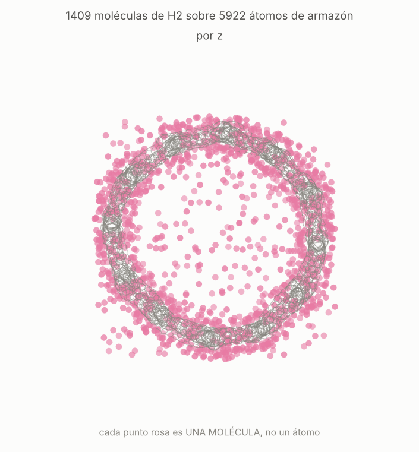
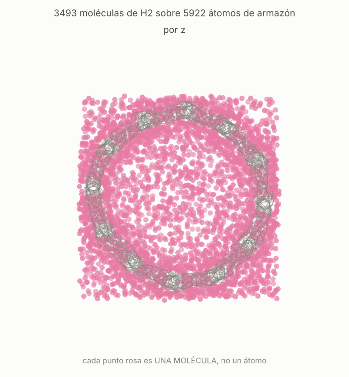

# Hidrógeno a 77 K en tres superestructuras

Adsorción de H₂ por Monte Carlo gran canónico en súper-grafeno, supertubo
(6,6) y superfulereno-C60, a 77 K y 1, 3.8 y 10 MPa. Son las mismas tres
presiones que las schwarzitas de `validacion_schwarzitas/`, para que las
seis se lean en una sola tabla.

Esto **no es una validación**: no hay isoterma publicada de ninguna de las
tres contra la que comparar. Lo que se valida está en
`validacion_GCMC/` (el haz de Levesque, reproducido a cinco decimales).
Aquí el código ya validado se aplica a estructuras nuevas, y lo que se
puede comprobar es la coherencia interna y la plausibilidad de clase.

## Lo primero fue meterlas en una celda legal

Ninguna de las tres es periódica en tres direcciones: el súper-grafeno es
una lámina (periódica en x,y), el supertubo sólo a lo largo de su eje, y
el superfulereno es una jaula finita. El GCMC exige tres ejes periódicos,
celda ortorrómbica y cada arista ≥ 2×corte, o sea ≥ 24 Å al corte de
12 Å. Hubo que empotrarlas, y las dos operaciones que eso requiere **no
son la misma clase de decisión**:

- **Replicar un eje periódico corto hasta pasar de 24 Å no decide nada.**
  Una celda replicada es el mismo cristal. Verificado contando los
  enlaces bajo PBC contra la lista que escribió el constructor:
  1770, 8883 y 11259, exactos en las tres.
- **La separación entre imágenes en los ejes libres sí decide.** Es
  empaquetamiento, y hay que elegirlo y declararlo. Se usó 3.4 Å, el
  contacto grafítico, que es el sólido más denso que estos objetos
  forman sin tocarse.

Y la separación no afecta a todo por igual. Medido en el súper-grafeno a
3.4, 7 y 12 Å:

| separación | área (m²/g) | canal libre | vacío | poro (cm³/g) |
|---|---|---|---|---|
| 3.4 Å | 2249.7 | 18.46 Å | 0.448 | 0.608 |
| 7 Å | 2337.3 | 18.46 Å | 0.544 | 0.894 |
| 12 Å | 2337.3 | 18.46 Å | 0.631 | 1.29 |

**El área y el canal son del objeto; el vacío y el volumen de poro son de
la caja.** A 3.4 Å el contacto entre láminas tapa un 4 % de superficie y
de 7 Å en adelante está convergida; el canal no se mueve en absoluto. El
vacío y el poro, en cambio, crecen sin límite con la separación, porque
son vacío que elegimos. Cualquier número que dependa de ellos —el exceso,
entre otros— hay que leerlo sabiendo esto.

## Las estructuras, y una que está rota

Construidas con `nanocarbon_lab` desde los presets del catálogo. La
columna de presupuesto compara `sum(6-n)` medido contra el que fija la
topología del grafo antes de mallar nada, que es una comprobación
independiente:

| | átomos | censo no hexagonal | presupuesto | enlaces (Å) | veredicto |
|---|---|---|---|---|---|
| súper-grafeno | 1180 | 5:42 7:62 8:2 | −24 = −24 | 1.344 / 1.420 / 1.544 | TENSO |
| supertubo (6,6) | 5922 | 5:149 7:401 8:18 | −288 = −288 | 1.316 / 1.420 / **1.568** | **ROTO** |
| superfulereno C60 | 7506 | 5:192 7:510 8:21 | −360 = −360 | 1.306 / 1.420 / 1.538 | TENSO |

**El supertubo sale roto y se usó igualmente, con esto escrito al lado.**
Un enlace de 1.568 Å queda fuera de la ventana sp² (1.30–1.55). Se probó
la cura obvia —ensanchar los struts de 14 a 16 Å, 6840 átomos— y el peor
enlace salió **1.567 Å**: idéntico. O sea que no es tensión del strut que
se cure ensanchando, está en el nodo. El resto de la estructura está
sana: 0 contactos cercanos, 94 % de las disclinaciones en el lado de la
curvatura que les toca, sumas de ángulos 329.5–360° (por encima del
umbral de colapso, 328.4°). Es **un enlace de ~10 000 un 1 % fuera de un
umbral duro**, no una red desgarrada. Aun así, su isoterma es la menos
fiable de las tres y no debería citarse sin la advertencia.

## Porosidad (3.4 Å de separación, 200 000 muestras, semilla 0)

| | celda (Å) | vacío | vacío de He | poro (cm³/g) | área (m²/g) | cavidad | canal |
|---|---|---|---|---|---|---|---|
| súper-grafeno | 32.9 × 57.0 × 34.0 | 0.448 | 0.808 | 0.608 | 2250 | 22.19 Å | 18.46 Å |
| supertubo | 88.2 × 89.7 × 47.8 | 0.774 | 0.904 | 2.479 | 2184 | 64.12 Å | 62.34 Å |
| superfulereno | 79.0 × 77.3 × 75.3 | 0.766 | 0.900 | 2.350 | 2155 | 63.44 Å | 33.39 Å |

Las tres cruzan con muchísima holgura el diámetro de la sonda, así que el
GCMC tiene algo que medir. Las áreas son geométricas, de sonda rodada
sobre esferas duras — **no son áreas BET** y no deben compararse con una
como si lo fueran.

## Las isotermas

1.5 × 10⁶ pasos de equilibrado y 1.5 × 10⁶ de producción por punto,
semilla 0, corte 12 Å, Feynman-Hibbs activo (a 77 K vale un 20 %).

| | P (MPa) | N | ± | ρ abs | exceso | wt% abs | wt% exc | min |
|---|---|---|---|---|---|---|---|---|
| súper-grafeno | 1.0 | 543.8 | 1.6 | 0.02851 | +0.02587 | 3.72 | +3.39 | 15.6 |
| | 3.8 | 706.0 | 1.3 | 0.03701 | +0.02604 | 4.78 | +3.41 | 17.4 |
| | 10.0 | 803.2 | 1.3 | 0.04211 | +0.01255 | 5.40 | +1.67 | 18.6 |
| supertubo | 1.0 | 1379.1 | 3.4 | 0.01221 | +0.00926 | 3.76 | +2.88 | 23.6 |
| | 3.8 | 2492.0 | 7.5 | 0.02206 | +0.00979 | 6.60 | +3.04 | 36.7 |
| | 10.0 | 3509.4 | 9.0 | 0.03107 | **−0.00200** | 9.05 | **−0.64** | 50.1 |
| superfulereno | 1.0 | 1702.4 | 4.0 | 0.01240 | +0.00946 | 3.67 | +2.82 | 27.4 |
| | 3.8 | 3066.6 | 5.7 | 0.02234 | +0.01013 | 6.42 | +3.01 | 44.4 |
| | 10.0 | 4317.5 | 9.1 | 0.03145 | **−0.00146** | 8.80 | **−0.45** | 78.0 |

Densidades en g/cm³. El wt% en exceso se calcula desde la **masa** en
exceso, `100 m_exc/(m_exc + m_C)`, no reescalando el porcentaje absoluto:
el wt% no es lineal en la masa adsorbida y reescalar se equivoca en un
pequeño porcentaje.

**El coste escala con la carga, no con el tamaño del marco.** El
súper-grafeno entero costó menos que un solo punto del superfulereno
pese a tener sólo un 16 % menos de área, porque adsorbe cuatro veces
menos moléculas. Y el coste por molécula no es constante: sube con la
densidad, así que extrapolar el coste de una estructura a otra
subestima (se midió: predicción 62 min contra 78 reales).

## El exceso negativo es una convención, no una repulsión

Dos de las tres dan exceso **negativo** a 10 MPa, y con holgura
estadística: −226 ± 9 moléculas en el supertubo y −200 ± 9 en el
superfulereno, veinte y pico veces el error de bloque. No es ruido.

Tampoco es física. El exceso es `ρ_abs − ρ_gas × f_vacío`, así que
**depende de qué fracción de vacío se reste**, y el módulo mide dos:

| marco | f(He) | f(esfera dura) | exceso con He | exceso con dura | se anula en |
|---|---|---|---|---|---|
| súper-grafeno | 0.808 | 0.448 | +0.0126 | +0.0257 | 1.151 |
| Schwarz P | 0.854 | 0.537 | +0.0135 | +0.0251 | 1.223 |
| giroide | 0.867 | 0.548 | +0.0143 | +0.0260 | 1.257 |
| Schwarz D | 0.721 | 0.266 | +0.0164 | +0.0330 | 1.168 |
| supertubo | 0.904 | 0.774 | **−0.0020** | **+0.0027** | **0.849** |
| superfulereno | 0.900 | 0.766 | **−0.0015** | **+0.0035** | **0.860** |

**En los dos marcos huecos las dos convenciones dan signos opuestos.** La
última columna es la fracción de vacío a la que el exceso valdría cero,
`ρ_abs/ρ_gas`: 0.849 y 0.860, contra las de helio 0.904 y 0.900. Basta
que el vacío de helio sobreestime en un **5–6 %** el volumen realmente
disponible al H₂ para que el signo se invierta — y sobreestimar es
exactamente lo que hace, porque el helio es más pequeño que el H₂ y
porque la media de Widom `⟨exp(−βU)⟩` a 77 K cuenta su atracción además
de su exclusión. En los otros cuatro marcos un 5 % no toca nada, porque
hay exceso de sobra; en estos dos lo decide todo, porque casi no hay.

Así que: **en un marco con vacío por encima de 0.9, la elección de
convención se vuelve la incertidumbre dominante**, y el número hay que
darlo con la convención escrita al lado. La conclusión *física* sobre el
supertubo no depende de eso y las instantáneas la enseñan directamente:

| | |
|---|---|
|  |  |
| 1 MPa, 1409 moléculas | 10 MPa, 3493 moléculas |

A 1 MPa el hidrógeno forma un **anillo pegado a la pared** y el interior
del tubo está casi vacío: eso es adsorción. A 10 MPa la caja entera está
llena por igual, dentro y fuera, y el hueco de 62 Å ya no se distingue
del exterior: a esa presión el tubo no es un adsorbente, es un
recipiente. Mismo marco, misma vista, misma escala.

El caso sano, para comparar, es el súper-grafeno a 1 MPa
([`supergrafeno_P1MPa.png`](supergrafeno_P1MPa.png)): las moléculas se
alinean en **capas sobre las láminas**, siguiendo la superficie, que es
la firma de la fisisorción en un poro de tipo rendija.

## Qué dicen, puestas junto a las schwarzitas

A 3.8 MPa, ordenadas por ancho de canal. La última columna es el exceso
dividido por lo que predice la regla de Chahine (1 wt% por cada
500 m²/g a 77 K), o sea **captación por unidad de área**:

| marco | área | canal | wt% abs | wt% exc | / Chahine |
|---|---|---|---|---|---|
| Schwarz D | 1717 | 6.72 Å | 3.68 | 2.82 | 0.82 |
| Schwarz P | 2543 | 14.61 Å | 6.07 | 4.32 | 0.85 |
| giroide | 2534 | 15.80 Å | 6.37 | **4.57** | **0.90** |
| súper-grafeno | 2250 | 18.46 Å | 4.78 | 3.41 | 0.76 |
| superfulereno | 2155 | 33.39 Å | 6.42 | 3.01 | 0.70 |
| supertubo | 2184 | 62.34 Å | 6.60 | 3.04 | 0.70 |

Las seis tienen área parecida (2150–2550, salvo la D), así que **la
diferencia no está en cuánta superficie hay sino en cómo se usa**: el
exceso va de 2.8 a 4.6 wt%. Y la eficiencia por área cae de forma
monótona por encima de ~16 Å: 0.90 → 0.76 → 0.70 → 0.70. **Las tres
superestructuras quedan por debajo de las tres schwarzitas.** Son
demasiado abiertas: a la escala a la que se construyeron, el hueco que
abren es mucho mayor que el alcance del potencial, y la superficie de más
no compensa el volumen que hay que llenar de gas.

Lo que la serie **no** resuelve es dónde está el óptimo por debajo de
15 Å: el único dato ahí, la Schwarz D a 6.72 Å, no es el mejor de la
tabla. Estas seis varían área, ancho y curvatura a la vez, así que nada
es separable. Separarlo pide una rendija de grafeno con la separación
barrida, que fija la química y la curvatura y mueve sólo el ancho.

## Límites

- Marco **rígido**: no se relaja ni vibra. A 77 K es la aproximación
  habitual para carbono, no una verdad.
- H₂ es **una esfera**: sin cuadrupolo y sin rotaciones. Para carbono
  apolar es defendible; para un marco dopado o funcionalizado no lo
  sería, y ese trabajo pide σ/ε por elemento, que no está.
- **Sin cargas**, así que nada de electrostática.
- Las áreas son geométricas, no BET (ver arriba).
- El supertubo está **roto** por un enlace (ver arriba).
- El aviso de deriva del punto de 1 MPa del superfulereno es un **falso
  positivo**, y vale la pena saber por qué (abajo).

## El aviso de deriva saltó sobre ruido, no sobre sesgo

El punto de 1 MPa del superfulereno avisó de una deriva de **−42
moléculas** entre el primer bloque de producción y el último, que es el
aviso de "el equilibrado no había terminado cuando empezó el promedio".
Se repitió en una carpeta aparte (`superfulereno_1MPa_repetido.json`) con
el equilibrado **triplicado** a 4.5 × 10⁶ pasos — en carpeta aparte
porque el `muestreo` es uno por carpeta y cambiarlo in situ haría que el
archivo describiera mal a los otros dos puntos.

| | N | ± | wt% abs | wt% exceso | deriva | min |
|---|---|---|---|---|---|---|
| original, equil. 1.5 × 10⁶ | 1702.4 | 4.0 | 3.67 | +2.82 | **−42.0** | 27.4 |
| repetido, equil. 4.5 × 10⁶ | 1698.8 | 6.5 | 3.66 | +2.82 | **+35.3** | 67.6 |

**La media no se movió y la deriva cambió de signo.** 3.6 moléculas de
diferencia, un 0.2 %, muy dentro de los errores combinados; el wt% en
exceso coincide a dos decimales. Si el aviso estuviera señalando un
equilibrado incompleto, triplicarlo tendría que haberlo reducido, no
invertido.

Así que lo que el test está midiendo es **fluctuación lenta, no sesgo**.
La razón es la forma del test: compara el **primer** bloque de producción
con el **último**, que es comparar dos medias de un solo bloque cada una
— la comparación más ruidosa posible de las que se podrían hacer con los
mismos datos. Con M bloques en la mano, un ajuste lineal sobre todos, o
la primera mitad contra la segunda, tendría una fracción del ruido. Los
dos casos saltan además rozando el segundo criterio (2 % de ⟨N⟩ = 34.0,
contra 42.0 y 35.3), que es lo que cabe esperar de un umbral que el ruido
cruza y vuelve a cruzar.

**El número de 1 MPa, por tanto, es bueno**, y es el original el que
queda en la tabla de arriba: 2.82 wt% en exceso por las dos vías. Lo que
queda señalado es el diagnóstico, no el punto.

## Reproducir

```bash
# 1. construir (nanocarbon_lab)
nanocarbon supernetwork --graph super-graphene --scale 34.0 \
    --tube-radius 5.0 --blend 4.0 --out supergrafeno
nanocarbon supernetwork --graph "supertube-(6,6)" --scale 14.0 \
    --tube-radius 3.0 --blend 2.0 --out supertubo
nanocarbon supernetwork --graph superfullerene-C60 --scale 14.2 \
    --tube-radius 3.0 --blend 2.0 --out superfulereno

# 2. empotrar en una celda ortorrómbica periódica (exporta_super.py)
# 3. la isoterma, como carpeta
carbonforge adsorcion isoterma estructura.extxyz iso_X \
    --temperatura 77 --presiones 1,3.8,10 \
    --equilibrado 1500000 --produccion 1500000 --instantaneas 1
python -m carbonforge.adsorption.run iso_X
```

Reanuda: los puntos que ya están en `resultados.json` no se recalculan.
