# Validación frente a GPAW: gráficos y tablas

Generado por `python -m tbkit.recipes.validation_figures` desde las referencias GPAW de `tbkit/parameters/references` y los resultados de `validation/`. No editar a mano.

## Bandas de grafeno y nanotubos

GPAW PBE ondas planas (400 eV) frente a tres conjuntos de carbono. (8,0), (5,5) y grafeno a tres constantes de red se usaron para ajustar `c_bandas`; (10,0), (9,0) y (6,6) quedaron fuera del ajuste. Nanotubos de Γ a Z.

### GPAW frente a c_bandas

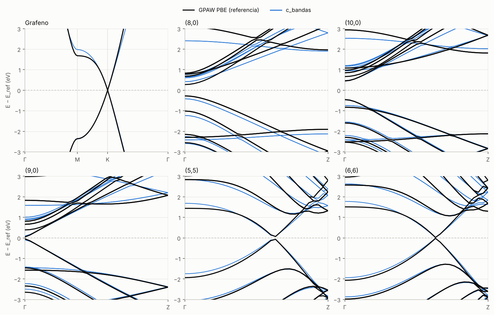

### GPAW frente a Xu (sp³)

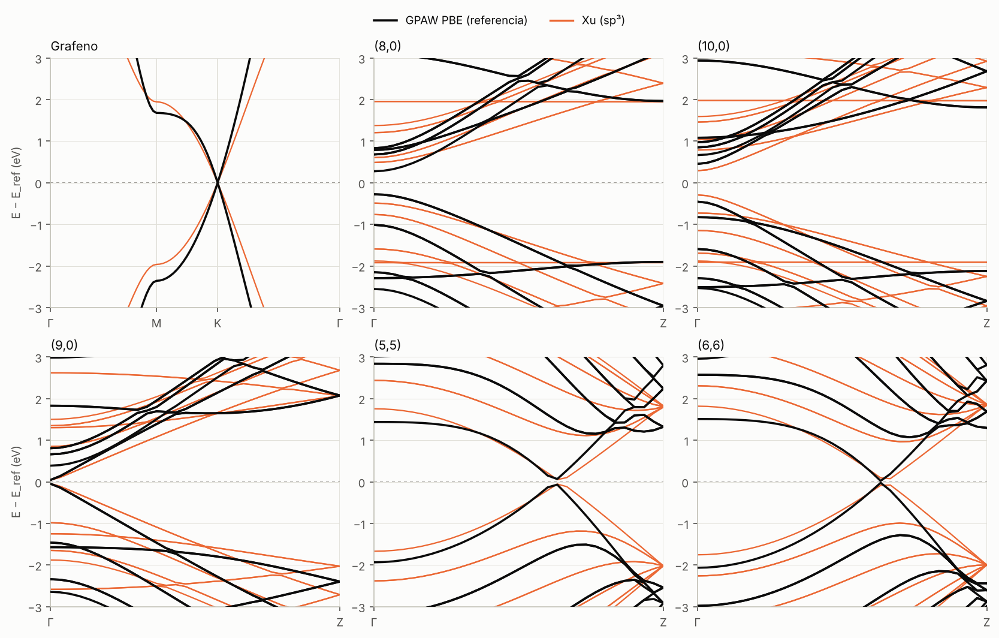

### GPAW frente a tang_carbon

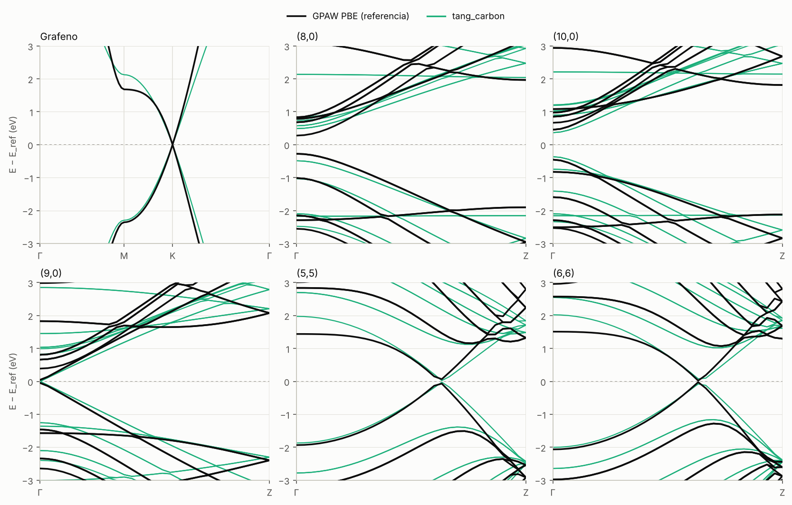

| Sistema | gap GPAW (eV) | c_bandas: RMS ±1 eV | c_bandas: gap | Xu (sp³): RMS ±1 eV | Xu (sp³): gap | tang_carbon: RMS ±1 eV | tang_carbon: gap |
|---|---|---|---|---|---|---|---|
| Grafeno | 0,00 | 0,02 | 0,00 | 0,12 | 0,00 | 0,07 | 0,00 |
| (8,0) | 0,55 | 0,17 | 0,83 | 0,17 | 0,98 | 0,19 | 0,98 |
| (10,0) | 0,91 | 0,09 | 0,94 | 0,17 | 0,58 | 0,12 | 0,73 |
| (9,0) | 0,09 | 0,21 | 0,20 | 0,20 | 0,09 | 0,18 | 0,00 |
| (5,5) | 0,00 | 0,06 | 0,00 | 0,16 | 0,00 | 0,12 | 0,00 |
| (6,6) | 0,00 | 0,04 | 0,00 | 0,16 | 0,00 | 0,11 | 0,00 |

RMS de bandas en eV, dentro de ±1 eV del nivel de referencia (`validation/bands_tb_vs_gpaw.json`).

### Grafeno deformado: el ajuste de c_bandas

Las tres constantes de red con las que se ajustaron las leyes de distancia de `c_bandas`; ventana del ajuste −9 a +3 eV.

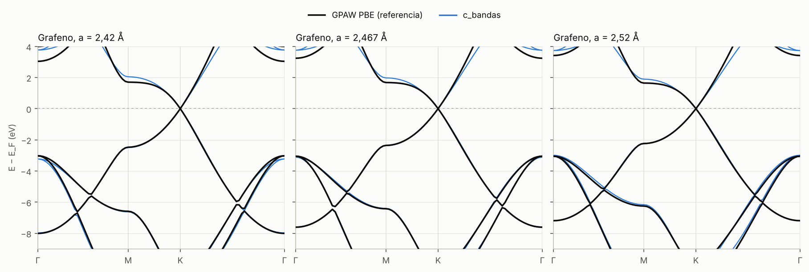

| grafeno | RMS c_bandas (eV) | RMS Xu (eV) | v_F GPAW (eV·Å) | v_F c_bandas | v_F Xu |
|---|---|---|---|---|---|
| a = 2,42 Å | 0,11 | 2,85 | 5,48 | 5,33 | 4,25 |
| a = 2,467 Å | 0,07 | 2,60 | 5,32 | 5,15 | 4,10 |
| a = 2,52 Å | 0,10 | 2,33 | 5,14 | 4,96 | 3,94 |

(`validation/c_bandas_fit.json`.)

## Bandas de bicapas y grafito

GPAW PBE (bandas sin D3, que no cambia los autovalores) frente a `c_capas` y `xu_capas`, los dos con salto entre capas. ABC queda fuera del ajuste.

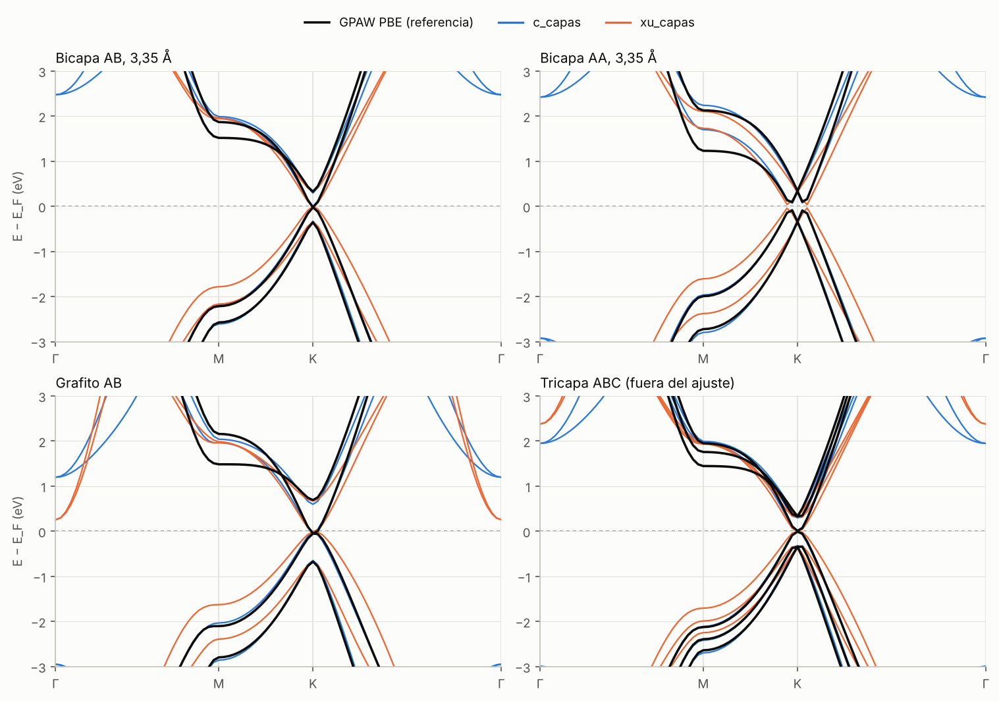

| Sistema | papel | c_capas: RMS bandas | c_capas: niveles en K | xu_capas: RMS bandas | xu_capas: niveles en K |
|---|---|---|---|---|---|
| AB@3.0 | ajuste | 0,13 | 0,110 | 0,38 | 0,028 |
| AB@3.35 | ajuste | 0,13 | 0,027 | 0,36 | 0,018 |
| AB@3.7 | ajuste | 0,14 | 0,037 | 0,36 | 0,011 |
| AA@3.35 | ajuste | 0,15 | 0,031 | 0,37 | 0,028 |
| graphite@3.35 | ajuste | 0,15 | 0,052 | 0,38 | 0,033 |
| ABC@3.35 | fuera | 0,13 | 0,024 | 0,35 | 0,004 |
| graphene | ajuste | 0,07 | — | 2,60 | — |

RMS en eV: bandas dentro de ±3 eV de E_F; niveles en K dentro de ±1,5 eV (`validation/interlayer_tb_vs_gpaw.json`).

### Energía de enlace entre capas

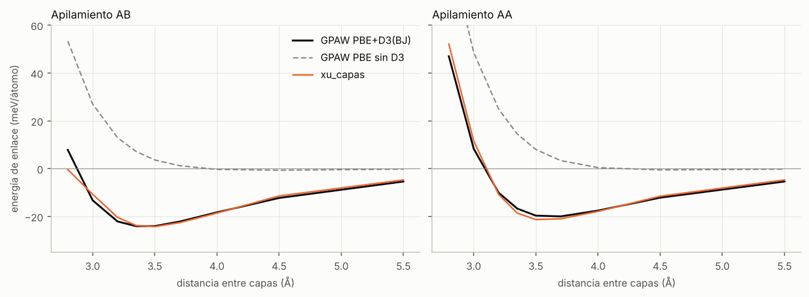

| Apilamiento | d_eq PBE+D3 (Å) | d_eq xu_capas (Å) | enlace PBE+D3 (meV/át.) | enlace xu_capas (meV/át.) |
|---|---|---|---|---|
| AB | 3,42 | 3,45 | -24,3 | -24,4 |
| AA | 3,61 | 3,57 | -20,2 | -21,5 |

## Bandas de MoS₂ y Mo

GPAW PBE ondas planas (500 eV, Mo con 6 electrones, sin espín-órbita) frente a `xu_chnosmo`. Todas las deformaciones de MoS₂ y el Mo bcc entraron en el ajuste: no hay cristal apartado.

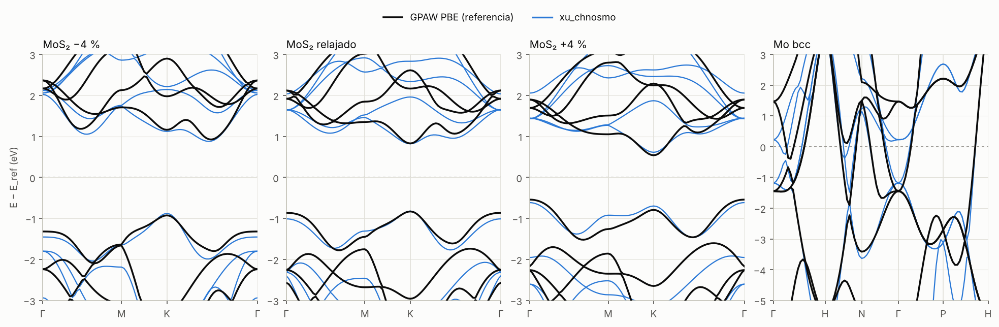

| Sistema | gap GPAW (eV) | gap TB (eV) | máx. valencia / mín. conducción GPAW | ídem TB | RMS bandas ±3 eV (eV) |
|---|---|---|---|---|---|
| MoS₂ −4 % | 1,85 | 1,76 | K / Q | K / Q | 0,29 |
| MoS₂ relajado | 1,66 | 1,64 | K / K | K / K | 0,33 |
| MoS₂ +4 % | 1,08 | 1,23 | Γ / K | Γ / K | 0,33 |
| Mo bcc | metal | metal | — | — | 0,49 |

Q: el mínimo de conducción entre K y Γ. El RMS incluye el peso de los bordes del ajuste desactivado (peso 1).

### Energía y fuerzas de MoS₂ y Mo con xu_chnosmo

Solo tres puntos por cristal (−2 %, 0, +2 %): las líneas los unen, no son una curva calculada. La red de MoS₂ sale demasiado rígida, y en Mo bcc la celda de GPAW no es un mínimo de tbkit (las dos deformaciones bajan la energía): `xu_chnosmo` no sirve para la energía de la red del metal.

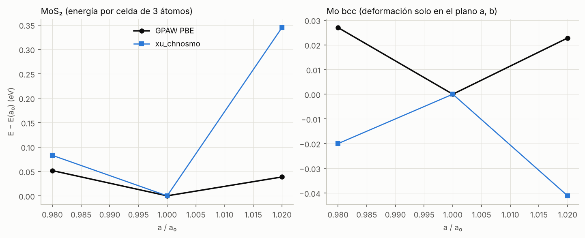

| cristal | punto | RMS fuerzas TB − GPAW (eV/Å) | |F| GPAW (eV/Å) | ΔE TB (eV) | ΔE GPAW (eV) |
|---|---|---|---|---|---|
| MoS2 | relaxed | 0,41 | 0,01 | 0,000 | 0,000 |
| MoS2 | rnd0 | 0,44 | 0,89 | 0,100 | 0,135 |
| MoS2 | rnd1 | 1,39 | 1,48 | 0,414 | 0,354 |
| MoS2 | rnd2 | 0,45 | 1,15 | 0,171 | 0,213 |
| MoS2 | x0.98 | 0,44 | 0,20 | 0,083 | 0,052 |
| MoS2 | x1.02 | 0,36 | 0,19 | 0,345 | 0,039 |
| Mo_bcc | relaxed | 0,00 | 0,00 | 0,000 | 0,000 |
| Mo_bcc | rnd0 | 0,00 | 0,00 | 0,000 | 0,000 |
| Mo_bcc | rnd1 | 0,00 | 0,00 | 0,000 | 0,000 |
| Mo_bcc | rnd2 | 0,00 | 0,00 | 0,000 | 0,000 |
| Mo_bcc | x0.98 | 0,00 | 0,00 | -0,020 | 0,027 |
| Mo_bcc | x1.02 | 0,00 | 0,00 | -0,041 | 0,023 |

## Cristales y láminas dopadas

Cada conjunto en su cristal, en geometrías GPAW (LCAO dzp, PBE): relajada, ±2 % y tres desplazamientos aleatorios.

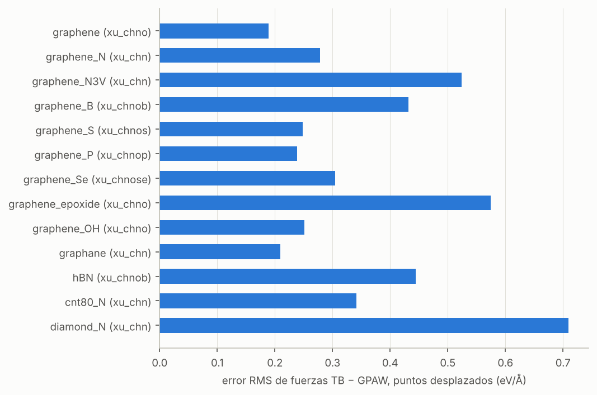

| cristal | conjunto | átomos | RMS fuerzas (eV/Å) | |F| GPAW típico (eV/Å) | máx. |ΔE TB − ΔE GPAW| (eV) |
|---|---|---|---|---|---|
| graphene | xu_chno | 32 | 0,19 | 3,14 | 0,66 |
| graphene_N | xu_chn | 32 | 0,28 | 3,08 | 0,50 |
| graphene_N3V | xu_chn | 31 | 0,52 | 3,05 | 0,72 |
| graphene_B | xu_chnob | 32 | 0,43 | 3,19 | 0,51 |
| graphene_S | xu_chnos | 32 | 0,25 | 3,14 | 0,48 |
| graphene_P | xu_chnop | 32 | 0,24 | 3,11 | 0,60 |
| graphene_Se | xu_chnose | 32 | 0,30 | 3,12 | 0,48 |
| graphene_epoxide | xu_chno | 33 | 0,57 | 3,05 | 0,55 |
| graphene_OH | xu_chno | 34 | 0,25 | 2,93 | 0,58 |
| graphane | xu_chn | 16 | 0,21 | 1,64 | 0,05 |
| hBN | xu_chnob | 18 | 0,44 | 2,45 | 0,50 |
| cnt80_N | xu_chn | 64 | 0,34 | 2,70 | 0,83 |
| diamond_N | xu_chn | 64 | 0,71 | 2,32 | 1,73 |

(`validation/crystals_tb_vs_gpaw.json`.)

### Energías de los cristales

Energía de cada punto respecto a la celda relajada, por átomo, los 13 cristales juntos.

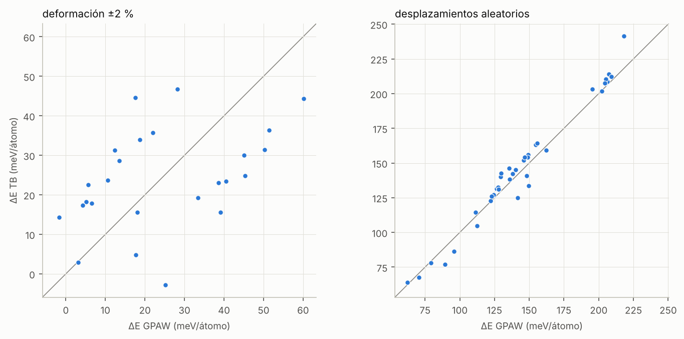

| puntos | n | MAE (meV/átomo) |
|---|---|---|
| deformación ±2 % | 26 | 15,6 |
| desplazamientos aleatorios | 39 | 6,3 |

## Gaps de moléculas

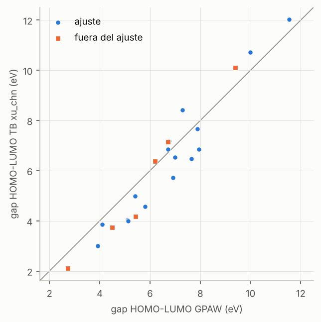

| grupo | moléculas | error medio (eV) | RMS (eV) | correlación |
|---|---|---|---|---|
| ajuste | 16 | -0,39 | 0,85 | 0,962 |
| fuera | 6 | -0,22 | 0,74 | 0,983 |

(`validation/electronic_tb_vs_gpaw.json`.)

## Infrarrojo de moléculas

Intensidades IR en las frecuencias GPAW de cada modo (las mismas para los dos), ensanchadas con lorentzianas de 20 cm⁻¹; cada panel normalizado a su máximo.

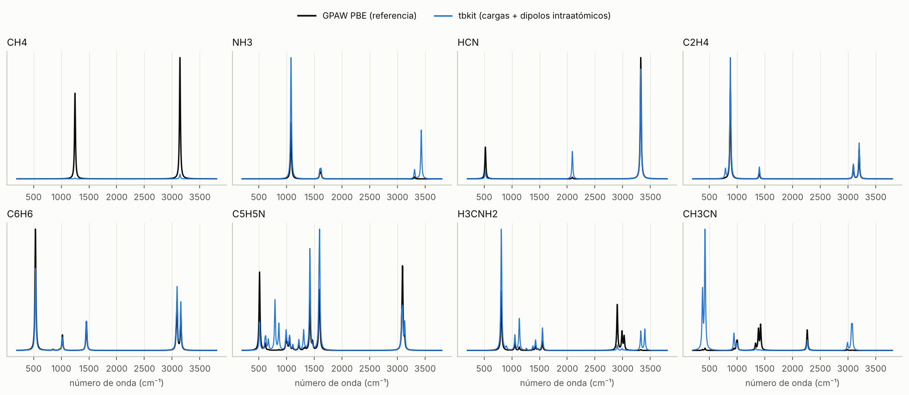

| molécula | modos intensos GPAW | correlación de intensidades | suma TB / suma GPAW |
|---|---|---|---|
| CH4 | 6 | 0,840 | 0,03 |
| NH3 | 4 | 0,958 | 2,78 |
| HCN | 5 | 0,927 | 1,11 |
| C2H4 | 4 | 0,997 | 1,38 |
| C6H6 | 8 | 0,949 | 0,96 |
| C5H5N | 15 | 0,598 | 1,49 |
| H3CNH2 | 8 | 0,665 | 1,56 |
| CH3CN | 9 | -0,321 | 2,84 |

(`validation/ir_tb_vs_gpaw.json`.)

## Frecuencias de moléculas

RMS frente a las frecuencias GPAW, cada método relajando desde la geometría GPAW.

| método | moléculas | RMS mediana (cm⁻¹) | RMS media (cm⁻¹) |
|---|---|---|---|
| tbkit | 63 | 92 | 97 |
| tbkit escalado | 63 | 80 | 84 |
| GFN1-xTB | 63 | 67 | 76 |
| GFN2-xTB | 63 | 56 | 69 |

(`validation/xtb_vs_tbkit.json`.)

### Frecuencias por archivo de referencia

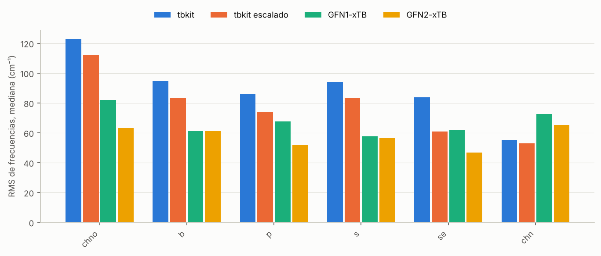

## Coil de 204 átomos: modos frente a PBE

Frecuencia PBE de cada modo TB como cociente de Rayleigh con fuerzas GPAW (cota superior si el modo TB no es un modo PBE). Escala PBE/TB: red de carbono 0,960, modos G 0,950.

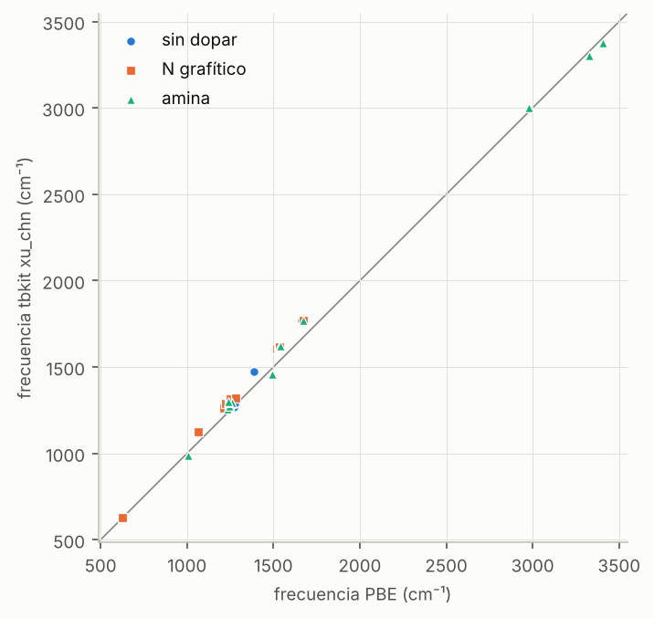

| estructura | suma IR TB (km/mol) | suma IR PBE (km/mol) | modos > 5 km/mol | dentro de un factor 2 |
|---|---|---|---|---|
| pristine | 214 | 220 | 3 | 2 |
| N | 205 | 234 | 8 | 7 |
| amine | 209 | 150 | 7 | 5 |

(`validation/coil204_doped_gpaw.json`.)

## Magnetismo: SCC con espín

Energía de cada estado respecto al fundamental de GPAW (cintas zigzag, triangulenos, H sobre grafeno, O₂, CH₂). λ se ajustó solo a zgnr6.

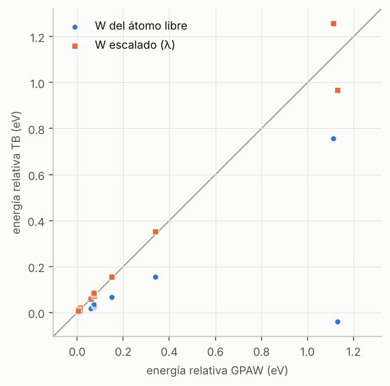

| sistema | estado | GPAW (eV) | TB (eV) | TB escalado (eV) |
|---|---|---|---|---|
| zgnr4 | FM | 0,012 | 0,006 | 0,020 |
| zgnr4 | NM | 0,059 | 0,018 | 0,059 |
| zgnr6 | FM | 0,005 | 0,005 | 0,013 |
| zgnr6 | NM | 0,074 | 0,026 | 0,074 |
| zgnr8 | FM | 0,004 | 0,004 | 0,007 |
| zgnr8 | NM | 0,075 | 0,031 | 0,081 |
| triangulene | BS | 0,338 | 0,154 | 0,352 |
| triangulene | NM | 0,338 | 0,154 | 0,352 |
| phenalenyl | NM | 0,149 | 0,067 | 0,155 |
| h_graphene | NM | 0,072 | 0,036 | 0,084 |
| O2 | S | 1,112 | 0,758 | 1,257 |
| CH2 | S | 1,129 | -0,038 | 0,966 |

(`validation/spin_tb_vs_gpaw.json`.)

### Momentos a lo ancho de las cintas zigzag

Momento de Mulliken (GPAW: el de la celda de cada átomo) del estado antiferromagnético, de un borde al otro.

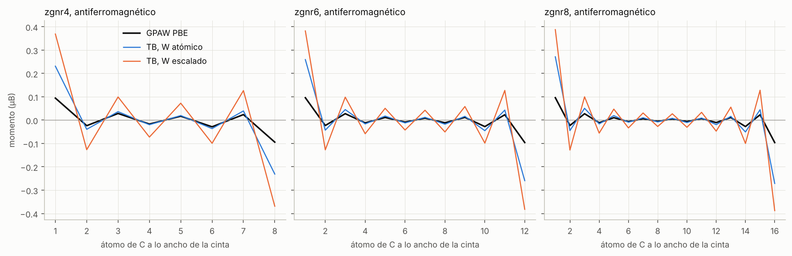

## XPS: desplazamientos de núcleo

TB (método del hueco, sin calibrar) frente a GPAW ΔSCF con setups de hueco de núcleo; desplazamientos respecto a CH₄, NH₃, H₂O y H₂Se. La diagonal es el acuerdo perfecto.

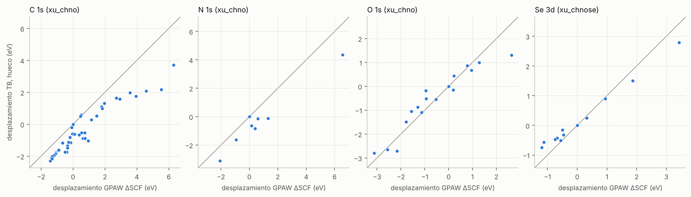

| Elemento | conjunto | método | sitios | r sin calibrar | MAE sin calibrar (eV) | r calibrado | MAE prueba (eV) |
|---|---|---|---|---|---|---|---|
| C | xu_chno | hole | 42 | 0,952 | 1,07 | 0,949 | 0,43 |
| C | xu_chno | z+1 | 42 | 0,946 | 1,10 | 0,946 | 0,36 |
| C | xu_chn | hole | 42 | 0,761 | 1,48 | 0,613 | 0,96 |
| C | xu_chn | z+1 | 42 | 0,842 | 3,78 | 0,842 | 0,95 |
| N | xu_chno | hole | 7 | 0,993 | 1,16 | 0,986 | 0,33 |
| N | xu_chno | z+1 | 7 | 0,942 | 2,32 | 0,942 | 1,43 |
| O | xu_chno | hole | 16 | 0,950 | 0,37 | 0,951 | 0,43 |
| Se | xu_chnose | hole | 12 | 0,994 | 0,31 | 0,997 | 0,09 |

(`validation/xps_tb_vs_gpaw.json`.)

## tbkit frente a xTB, ambos contra GPAW

Distancia a PBE (GFN no se ajustó a PBE: no es una medida de exactitud de GFN).

| referencias | método | RMS fuerzas, mediana (eV/Å) | MAE energías relativas (eV) | MAE gap (eV) |
|---|---|---|---|---|
| gpaw_chn.json | xu_chn | 0,39 | 0,084 | 0,73 |
| gpaw_chn.json | GFN1-xTB | 0,58 | 0,183 | 0,74 |
| gpaw_chn.json | GFN2-xTB | 0,64 | 0,210 | 2,26 |
| gpaw_chno.json | xu_chno | 0,57 | 0,236 | 0,49 |
| gpaw_chno.json | GFN1-xTB | 0,76 | 0,202 | 0,74 |
| gpaw_chno.json | GFN2-xTB | 0,77 | 0,199 | 1,38 |
| gpaw_b.json | xu_chnob | 0,31 | 0,091 | 0,50 |
| gpaw_b.json | GFN1-xTB | 0,57 | 0,197 | 0,60 |
| gpaw_b.json | GFN2-xTB | 0,63 | 0,229 | 0,77 |
| gpaw_p.json | xu_chnop | 0,36 | 0,101 | 0,45 |
| gpaw_p.json | GFN1-xTB | 0,56 | 0,222 | 0,86 |
| gpaw_p.json | GFN2-xTB | 0,61 | 0,253 | 1,23 |
| gpaw_s.json | xu_chnos | 0,41 | 0,083 | 0,82 |
| gpaw_s.json | GFN1-xTB | 0,65 | 0,212 | 0,42 |
| gpaw_s.json | GFN2-xTB | 0,70 | 0,227 | 0,59 |
| gpaw_se.json | xu_chnose | 0,29 | 0,056 | 0,51 |
| gpaw_se.json | GFN1-xTB | 0,57 | 0,185 | 0,39 |
| gpaw_se.json | GFN2-xTB | 0,56 | 0,179 | 0,57 |

(`validation/xtb_vs_tbkit.json`.)

### Bicapas: tbkit y xTB frente a PBE+D3

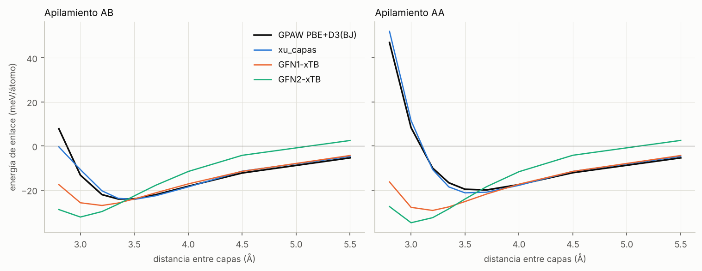

### Tiempo de cálculo

Segundos de reloj por energía + fuerzas de un flake triangular h-saturado (omp_num_threads=2), tbkit xu_chn con scc (kt 0,1 ev) frente a tblite (300 k).

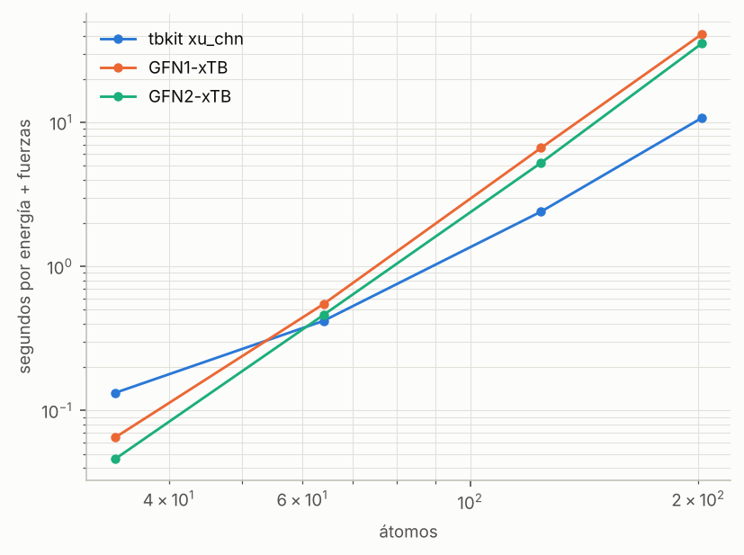

## Medido, no adoptado

Comparaciones con GPAW que llevaron a no adoptar un método. El error que cuenta es el de validación cruzada o el de las estructuras apartadas, no el de entrenamiento.

### Cargas de Born corregidas para el IR

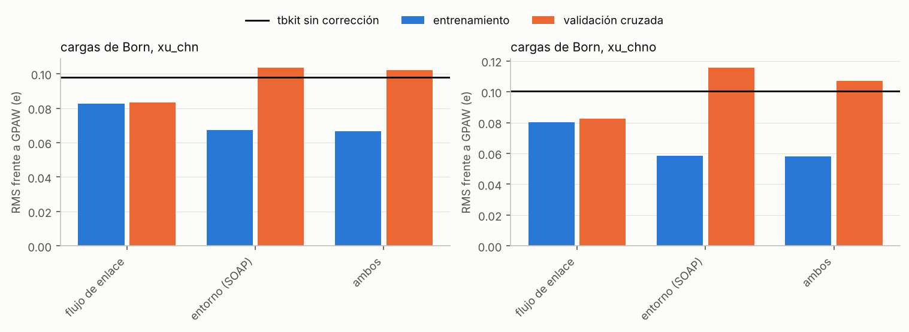

| conjunto | modelo | |log10 I_TB/I_GPAW| mediana, modos apartados | fracción dentro de un factor 2 |
|---|---|---|---|
| xu_chn | tbkit | 0,326 | 0,46 |
| xu_chn | flujo de enlace | 0,284 | 0,52 |
| xu_chn | entorno (SOAP) | 0,299 | 0,50 |
| xu_chn | ambos | 0,298 | 0,50 |
| xu_chno | tbkit | 0,342 | 0,46 |
| xu_chno | flujo de enlace | 0,275 | 0,54 |
| xu_chno | entorno (SOAP) | 0,292 | 0,51 |
| xu_chno | ambos | 0,287 | 0,51 |

### MACE-MP-0 sin ajuste fino

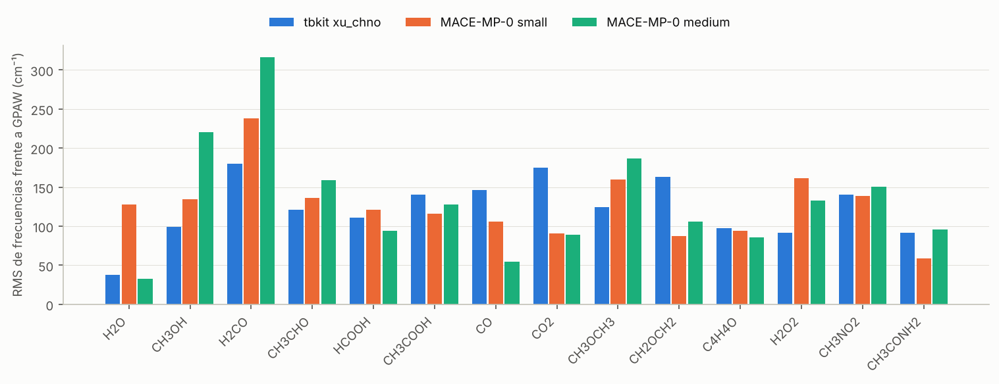

### Corrección Δ lineal (SOAP)

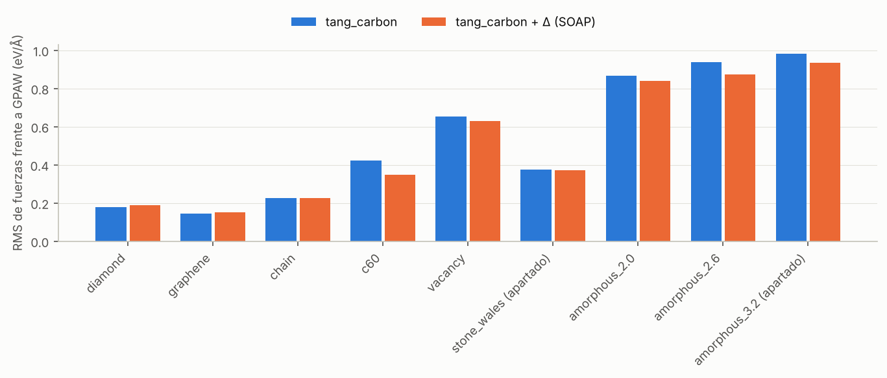

Validación cruzada por grupos, RMS de fuerzas con el mejor ridge: 0,68 eV/Å.

### Se con orbitales d (publicado como conjunto aparte)

Con d mejora el Se hipervalente (deriva de DMSeO y SeO₂) y empeoran las frecuencias de varias moléculas apartadas.

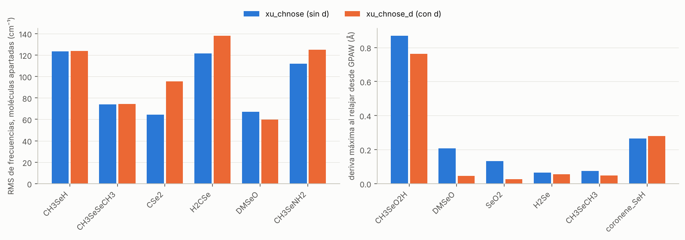
